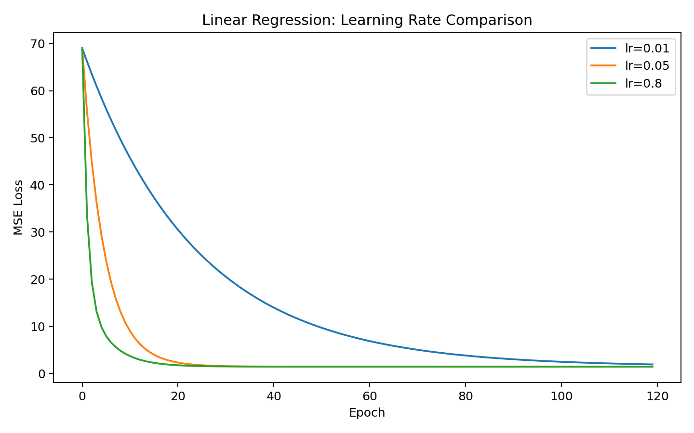
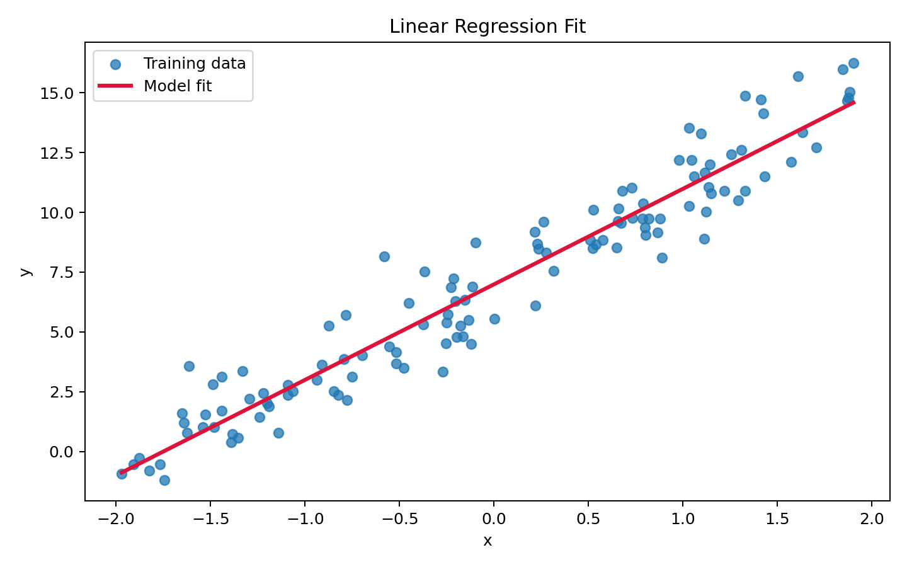
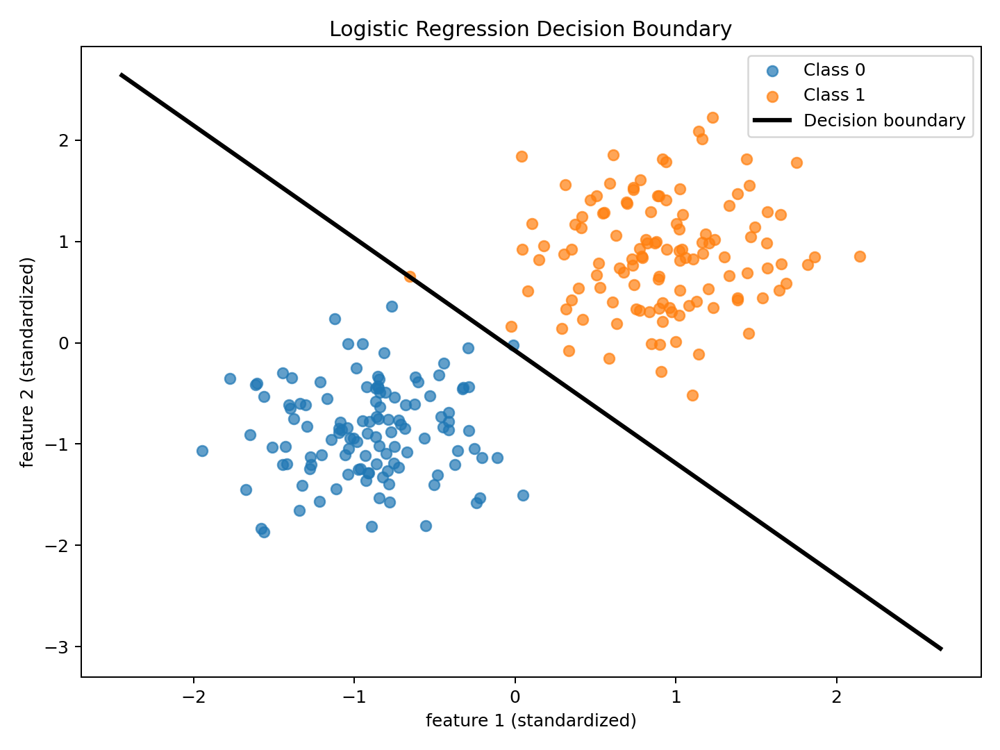
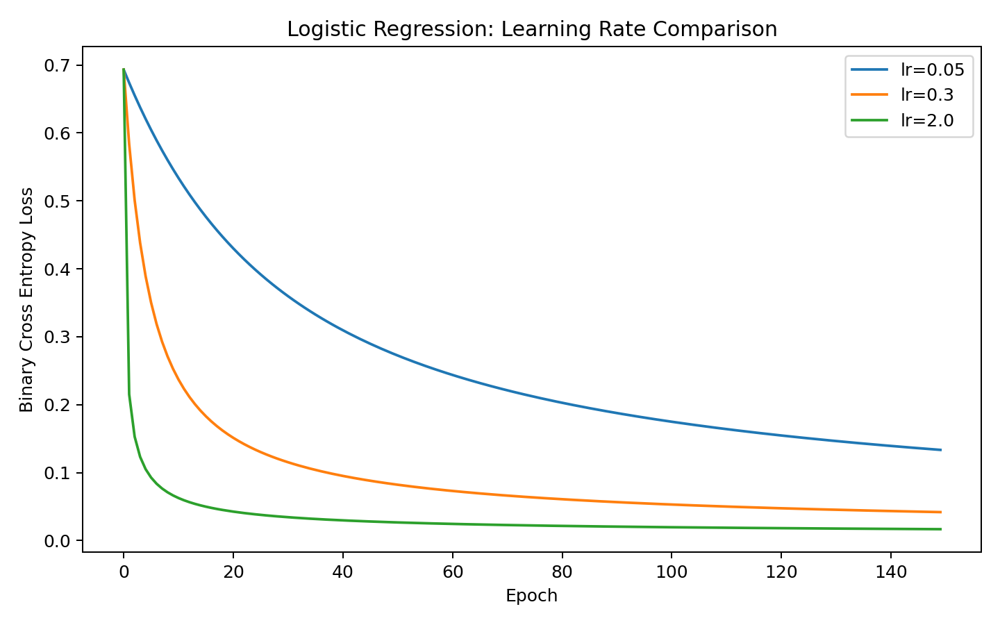

# 从线性回归到 Transformer

## 前言

前几天，一个朋友在知乎上刷到一个问题：**Transformer 里的 Q、K、V 到底是什么？**  
他是 Deep Learning 零基础，看了不少高赞回答，还是觉得云里雾里。我回头看了那些答案，发现问题本身没有错，答案本身也没有错，但它们普遍有一个共同问题：**默认读者已经具备了不少前置知识。**

如果一个人还没有真正理解下面这些最基础的问题：

- 模型是什么
- 参数是什么
- loss 是什么
- 梯度为什么能更新参数
- 为什么会有链式法则
- 为什么分类问题常用交叉熵而不是 MSE

那他很难真正理解 Transformer，更别说 Q、K、V、self-attention、mask、multi-head 这些概念。

所以这篇文章不打算一上来就解释 Q、K、V，也不打算直接扔出一张 Transformer 结构图就结束。更自然的做法是沿着一条尽量连续的技术链条往前走：

`线性模型 -> 多层感知机 -> 反向传播与优化 -> 序列建模 -> 注意力机制 -> Transformer`

本文先把整条链条里最基础、但也最容易被略过的那一段讲扎实：**线性回归、逻辑回归、损失函数、梯度下降和链式法则。** 如果这些东西没有真正理解，后面的 MLP、attention 和 Transformer 往往就只能靠背。

---

## 这篇文章想回答什么

读完这篇文章，你至少应该能回答下面这些问题：

1. 线性回归到底在做什么，为什么它可以被视为很多神经网络的最小原型？
2. 逻辑回归和线性回归到底差在哪里，为什么前者自然地走向分类和概率建模？
3. MSE 是什么，交叉熵又是什么，为什么分类任务通常更偏爱交叉熵？
4. 为什么交叉熵里要有 `log`，这个 `log` 的底数默认是什么？
5. `dL/dW = (2 / N) * X^T @ (y_pred - y_true)` 这种公式是怎么来的，链式法则到底在做什么？
6. `@`、`X^T`、`X ∈ R^(N x d)` 这些记号分别是什么意思，它们在代码里对应什么操作？
7. 为什么梯度下降真的能让 loss 变小，学习率又在训练里扮演什么角色？
8. 为什么只有线性变换还不够，为什么多层感知机必须引入非线性激活函数？
9. 反向传播在多层网络里到底是如何展开的，它和前面看到的链式法则是什么关系？
10. 为什么处理文本和序列时，MLP 会开始变得笨拙，RNN/LSTM 又试图解决什么问题？
11. 注意力机制到底在解决什么痛点，Q、K、V 这三个量分别扮演什么角色？
12. Self-Attention 和传统序列模型相比到底改变了什么，为什么它能更好地并行计算？
13. Transformer 中的位置编码、多头注意力、残差连接、LayerNorm 分别在解决什么问题？
14. Encoder、Decoder、Encoder-Decoder 这几种结构各自适合什么任务，它们和 BERT、GPT 之间是什么关系？
15. 当我们最终回到最初的问题时，是否能够用一条连续的技术脉络解释：Transformer 为什么会出现，它究竟比之前的方法好在哪里？

---

## 为什么要从线性模型开始

神经网络并不是凭空出现的。你今天看到的 MLP、RNN、Transformer，本质上都在回答同一个问题：

> 给定输入，如何通过一组可学习参数，得到更接近真实答案的输出？

线性回归和逻辑回归是这个问题最简单的两个版本。

- 线性回归告诉你：如果目标是连续值，怎么做建模。
- 逻辑回归告诉你：如果目标是类别，怎么把线性模型改成概率模型。

这两个模型虽然简单，但已经包含了后面所有深度学习模型的骨架：

- 输入
- 参数
- 前向计算
- 损失函数
- 梯度
- 参数更新

理解了这两个模型，再去看 MLP 和反向传播，很多东西就不会显得神秘。

---

## 一、线性回归

### 1.1 线性回归在做什么

线性回归解决的是**回归问题**，也就是预测一个连续数值。

例如：

- 根据面积预测房价
- 根据气温、湿度预测用电量
- 根据广告投入预测销量

最简单的一元线性回归公式是：

```text
y = wx + b
```

这里：

- `x` 是输入
- `w` 是权重
- `b` 是偏置
- `y` 是预测值

如果样本不止一个，或者特征不止一个，通常会写成矩阵形式：

```text
y_pred = XW + b
```

这就是代码里写的：

```python
return x @ weight + bias
```

### 1.2 读懂几个最基本的数学记号

刚接触机器学习时，最容易被这些记号绊住。这里一次性解释清楚。

#### `X ∈ R^(N x d)` 是什么意思

这句话读作：

> `X` 属于实数域上的 `N x d` 矩阵

翻译成人话就是：

- `X` 是一个矩阵
- 它有 `N` 行、`d` 列
- 里面的元素都是普通实数

在机器学习里，通常这样理解：

- `N` 表示样本数
- `d` 表示特征维度

所以：

```text
X ∈ R^(N x d)
```

通常表示“有 `N` 个样本，每个样本有 `d` 个特征”。

#### 当前这个例子里，`d` 是多少

在本文的线性回归实验里，输入数据是这样生成的：

```python
x = rng.uniform(-2.0, 2.0, size=(num_samples, 1))
```

所以：

- `x.shape = (N, 1)`
- 这意味着当前例子里 `d = 1`

也就是说，这是一元线性回归：每个样本只有 1 个特征。

#### `@` 是什么意思

在 Python 和 NumPy 里：

- `*` 表示逐元素乘法
- `@` 表示矩阵乘法

所以：

```python
X @ W
```

不是简单地“按位置相乘”，而是线性代数里的矩阵乘法。

如果：

- `X.shape = (N, d)`
- `W.shape = (d, 1)`

那么：

```text
X @ W -> (N, 1)
```

这正好得到 `N` 个样本各自的预测值。

#### `X^T` 是什么意思

`X^T` 表示 `X` 的**转置**，也就是把行和列交换。

如果：

```text
X.shape = (N, d)
```

那么：

```text
X^T.shape = (d, N)
```

它会在梯度公式里出现：

```text
dL/dW = (2 / N) * X^T @ (y_pred - y_true)
```

使用转置之后，结果的 shape 才能和 `W` 对齐。

---

### 1.3 数据是怎么生成出来的

本文的线性回归示例使用了下面这段代码来造数据：

```python
def make_regression_data(
    num_samples: int = 120,
    true_weight: float = 4.0,
    true_bias: float = 7.0,
    noise_std: float = 1.2,
    seed: int = 42,
) -> tuple[np.ndarray, np.ndarray]:
    rng = np.random.default_rng(seed)

    x = rng.uniform(-2.0, 2.0, size=(num_samples, 1))
    noise = rng.normal(loc=0.0, scale=noise_std, size=(num_samples, 1))
    y = true_weight * x + true_bias + noise
    return x, y
```

这段代码里最容易让初学者困惑的是这几项：

#### `rng` 是什么

`rng` 是随机数生成器，来自：

```python
rng = np.random.default_rng(seed)
```

它负责随机生成数据。这里设置了 `seed`，是为了保证每次运行都能得到同样的随机结果，便于复现。

#### `x` 是什么

`x` 是输入特征，也就是线性回归里的自变量。

```python
x = rng.uniform(-2.0, 2.0, size=(num_samples, 1))
```

这句话的意思是：

- 在 `[-2, 2]` 区间内随机采样
- 一共生成 `num_samples` 个样本
- 每个样本只有 1 个特征

所以 `x` 的 shape 是 `(num_samples, 1)`。

#### `noise` 是什么

`noise` 是噪声项：

```python
noise = rng.normal(loc=0.0, scale=noise_std, size=(num_samples, 1))
```

它的作用是让数据更接近真实世界。现实里的数据通常不会完美落在一条直线上，所以我们故意加入一点随机扰动。

#### `rng.uniform` 是什么意思

`rng.uniform(a, b, size=...)` 表示从**均匀分布**里采样。

```python
rng.uniform(-2.0, 2.0, size=(num_samples, 1))
```

就是在 `[-2, 2]` 这个区间里随机取数，每个位置被取到的机会差不多一样。

#### `rng.normal` 是什么意思

`rng.normal(loc=0.0, scale=noise_std, size=...)` 表示从**正态分布**里采样。

这里：

- `loc=0.0` 表示均值为 0
- `scale=noise_std` 表示标准差为 `noise_std`

所以我们最终得到的数据是：

```text
y = 4x + 7 + noise
```

这相当于先定义一条真实直线，再给每个样本加一点扰动。

---

### 1.4 线性回归是不是就是最小二乘法

可以这样理解，但要区分两个层面：

- **线性回归**是模型
- **最小二乘法**是拟合这个模型的一种目标或方法

线性回归描述的是模型形式：

```text
y = XW + b
```

最小二乘描述的是训练目标：

```text
让 Σ (y_true - y_pred)^2 尽可能小
```

所以更准确地说，应该是：

> 线性回归通常通过最小二乘法来拟合

如果你用的是均方误差 `MSE`，那本质上就是在做最小二乘。

---

### 1.5 MSE 是什么

`MSE` 是 `Mean Squared Error`，中文叫**均方误差**：

```text
MSE = mean((y_true - y_pred)^2)
```

为什么要平方？

- 正负误差不会互相抵消
- 大误差会被放大
- 对连续值回归来说，这个定义非常自然

代码里的实现就是：

```python
def mean_squared_error(y_true: np.ndarray, y_pred: np.ndarray) -> float:
    return float(np.mean((y_true - y_pred) ** 2))
```

---

### 1.6 梯度下降视角下的训练流程

线性回归训练的核心流程其实只有四步：

1. 前向计算：根据当前参数做预测
2. 计算损失：看看预测值离真实值有多远
3. 计算梯度：求参数往哪个方向改，loss 才会下降
4. 更新参数：把参数朝梯度反方向推一步

对应到代码里就是：

```python
for epoch in range(epochs):
    y_pred = predict(x, weight, bias)
    loss = mean_squared_error(y, y_pred)
    d_weight, d_bias = compute_gradients(x, y, y_pred)

    weight -= learning_rate * d_weight
    bias -= learning_rate * d_bias
```

这里最重要的一句是：

```python
weight -= learning_rate * d_weight
```

为什么是减号？因为：

- 梯度指向的是 loss 增长最快的方向
- 我们想让 loss 下降
- 所以更新时应该沿着梯度的反方向走

---

### 1.7 梯度公式为什么是这个样子

代码里的梯度计算是：

```python
num_samples = x.shape[0]
error = y_pred - y_true
d_weight = (2.0 / num_samples) * (x.T @ error)
d_bias = float((2.0 / num_samples) * np.sum(error))
```

它对应的数学公式是：

```text
dL/dW = (2 / N) * X^T @ (y_pred - y_true)
dL/db = (2 / N) * sum(y_pred - y_true)
```

接下来我们完整推导一遍。

#### 先定义单样本损失

对第 `i` 个样本，定义：

```text
y_pred_i = x_i^T W + b
e_i = y_pred_i - y_true_i
l_i = e_i^2
```

于是：

```text
l_i = (y_pred_i - y_true_i)^2
```

#### 为什么这里会出现链式法则

因为 `l_i` 不是直接由 `W` 算出来的，而是通过中间变量一层层依赖：

```text
W -> y_pred_i -> e_i -> l_i
```

也就是说：

- `W` 先影响预测值 `y_pred_i`
- `y_pred_i` 再影响误差 `e_i`
- `e_i` 最后影响损失 `l_i`

把它完全展开，`l_i` 实际上是一个套娃函数：

```text
l_i(W) = [ [x_i^T W + b] - y_true_i ]^2
```

链式法则正是用来处理这种“间接依赖”的。

#### 为什么链式法则会写成乘法

先看最简单的两层函数：

```text
z = f(y)
y = g(x)
```

当 `x` 发生一点微小变化 `dx` 时：

```text
dy ≈ (dy/dx) * dx
dz ≈ (dz/dy) * dy
```

把第二式里的 `dy` 用第一式代换掉：

```text
dz ≈ (dz/dy) * (dy/dx) * dx
```

所以：

```text
dz/dx = (dz/dy) * (dy/dx)
```

这就是最基本的链式法则。

如果中间再多一层：

```text
l = h(e)
e = g(y)
y = f(W)
```

同样可以得到：

```text
dl/dW = (dl/de) * (de/dy) * (dy/dW)
```

翻译成这道题里的变量，就是：

```text
∂l_i / ∂W
= ∂l_i / ∂e_i * ∂e_i / ∂y_pred_i * ∂y_pred_i / ∂W
```

也就是说：

> 总变化率 = 路径上每一段局部变化率的乘积

#### 为什么对向量 `W` 也成立

严格地说，`W` 不是一个标量，而是一个向量：

```text
W = [w_1, w_2, ..., w_d]^T
```

所以你也可以先对每个分量分别看：

```text
∂l_i / ∂w_j
= ∂l_i / ∂e_i * ∂e_i / ∂y_pred_i * ∂y_pred_i / ∂w_j
```

这对每个 `w_j` 都成立。

然后把所有分量的偏导数收集起来，就得到整个梯度向量：

```text
∂l_i / ∂W
```

所以向量情形并没有推翻链式法则，它只是把“对每个分量分别应用链式法则”再合并起来。

#### 计算图直觉

下面这张图把“正向计算”和“反向传导梯度”放到了一起：


读图时抓住两件事就够了：

- 正向计算时，值沿着 `W -> y_pred_i -> e_i -> l_i` 往前走
- 反向求梯度时，敏感度沿着 `l_i -> e_i -> y_pred_i -> W` 往回传

所以反向传播并不神秘，它本质上就是把链式法则系统化地应用在计算图上。

#### 正式推导 `∂l_i / ∂W`

因为：

```text
l_i = e_i^2
e_i = y_pred_i - y_true_i
y_pred_i = x_i^T W + b
```

所以：

```text
∂l_i / ∂W
= ∂l_i / ∂e_i * ∂e_i / ∂y_pred_i * ∂y_pred_i / ∂W
```

逐项求：

```text
∂l_i / ∂e_i = 2e_i
∂e_i / ∂y_pred_i = 1
∂y_pred_i / ∂W = x_i
```

连起来得到：

```text
∂l_i / ∂W = 2e_i * 1 * x_i = 2e_i x_i
```

代回 `e_i = y_pred_i - y_true_i`：

```text
∂l_i / ∂W = 2 (y_pred_i - y_true_i) x_i
```

#### 再推导 `∂l_i / ∂b`

同理：

```text
∂l_i / ∂b
= ∂l_i / ∂e_i * ∂e_i / ∂y_pred_i * ∂y_pred_i / ∂b
```

其中：

```text
∂y_pred_i / ∂b = 1
```

所以：

```text
∂l_i / ∂b = 2e_i = 2 (y_pred_i - y_true_i)
```

#### 从单样本推广到全部样本

总体损失：

```text
L = (1 / N) * Σ_i l_i
```

所以：

```text
∂L / ∂W
= (1 / N) * Σ_i ∂l_i / ∂W
= (1 / N) * Σ_i 2e_i x_i
= (2 / N) * Σ_i e_i x_i
```

```text
∂L / ∂b
= (1 / N) * Σ_i ∂l_i / ∂b
= (1 / N) * Σ_i 2e_i
= (2 / N) * Σ_i e_i
```

再写成矩阵形式：

```text
error = y_pred - y_true
```

则：

```text
∂L / ∂W = (2 / N) * X^T @ error
         = (2 / N) * X^T @ (y_pred - y_true)
```

```text
∂L / ∂b = (2 / N) * sum(error)
         = (2 / N) * sum(y_pred - y_true)
```

这就是代码里那两行梯度公式的来源。

#### `X^T @ error` 直觉上到底在做什么

这一项很值得单独看一眼：

```text
X^T @ error
```

如果：

- `X.shape = (N, d)`
- `X^T.shape = (d, N)`
- `error.shape = (N, 1)`

那么：

```text
(d, N) @ (N, 1) -> (d, 1)
```

结果 shape 正好和 `W` 一样。

更重要的是，它在数学上等价于：

```text
X^T @ error = Σ_i e_i x_i
```

也就是说：

- 每个样本都会贡献一份 `误差 × 特征`
- 然后这些贡献在每个特征维度上被汇总起来
- 最终形成“每个权重该怎么改”的总方向

你可以把它理解成：

> `X` 是按样本组织数据，`X^T` 则把视角切换成“按特征汇总误差贡献”

---

### 1.8 学习率到底影响了什么

下面这张图来自线性回归实验中三个学习率的对比：



这张图很适合建立学习率直觉：

- `lr=0.01`：能降，但很慢
- `lr=0.05`：下降速度和稳定性都比较好
- `lr=0.8`：在这个例子里也能收敛，但前期震荡更明显

需要强调的是，`0.8` 在这里还能工作，不代表大学习率总是安全。换一个数据分布或初始化方式，它就可能直接发散。

#### 这张图对应的实验设置

代码里设置的是：

```python
learning_rates = [0.01, 0.05, 0.80]
epochs = 120
```

运行日志的关键结果是：

- `lr=0.01` 最终 loss 约为 `1.93`
- `lr=0.05` 最终 loss 约为 `1.46`
- `lr=0.80` 最终 loss 也收敛到约 `1.46`

这说明学习率确实会显著影响收敛速度。

---

### 1.9 拟合结果长什么样

除了看 loss 曲线，另一个更直观的问题是：模型学出来的直线到底像不像数据本身？



这张图展示了：

- 散点：训练数据
- 红线：模型学到的拟合结果

在这组实验里，最终学到的参数大致是：

```text
w ≈ 3.996
b ≈ 6.989
```

而生成数据时的真实参数是：

```text
true_weight = 4.0
true_bias = 7.0
```

这说明线性回归已经把真实关系学得相当接近了。

---

### 1.10 本节最关键的结论

学完线性回归之后，你至少要真正理解三件事：

1. 模型的本质是：输入经过参数变换得到输出
2. 训练的本质是：通过梯度不断调整参数，让 loss 下降
3. 链式法则不是抽象公式，而是“影响沿依赖路径逐层传递”的规则

---

## 二、逻辑回归

### 2.1 逻辑回归和线性回归的区别是什么

最核心的一句话：

> 线性回归预测连续数值，逻辑回归预测类别概率。

更具体一点：

- 线性回归输出任意实数，适合房价、温度、销量这类回归任务
- 逻辑回归输出 `0` 到 `1` 之间的概率，适合二分类任务

你也可以把逻辑回归记成：

```text
逻辑回归 = 线性模型 + sigmoid + 交叉熵
```

#### 一个更清楚的对比

| 项目 | 线性回归 | 逻辑回归 |
| --- | --- | --- |
| 任务类型 | 回归 | 二分类 |
| 输出 | 连续数值 | 概率 |
| 前向形式 | `XW + b` | `sigmoid(XW + b)` |
| 常见损失 | MSE | Binary Cross Entropy |
| 最终结果 | 一个实数 | 一个类别概率，再阈值化 |

---

### 2.2 为什么逻辑回归能做分类

逻辑回归先做一次线性变换：

```text
z = XW + b
```

然后再过一个 `sigmoid`：

```text
p = sigmoid(z) = 1 / (1 + e^(-z))
```

这样输出 `p` 就会落在 `0` 到 `1` 之间，可以解释为“属于正类的概率”。

对应代码是：

```python
def sigmoid(z: np.ndarray) -> np.ndarray:
    z = np.clip(z, -500.0, 500.0)
    return 1.0 / (1.0 + np.exp(-z))


def predict_proba(x: np.ndarray, weight: np.ndarray, bias: float) -> np.ndarray:
    linear_output = x @ weight + bias
    return sigmoid(linear_output)
```

如果最后再加一个阈值，比如 `0.5`：

- `p >= 0.5` 判为 1
- `p < 0.5` 判为 0

就得到了最终分类结果。

---

### 2.3 交叉熵是什么

交叉熵可以先粗暴理解成一句话：

> 它衡量的是：模型给正确答案分配了多少概率。

如果模型把很高的概率给了正确类别，交叉熵就小；如果模型很自信地猜错了，交叉熵就会很大。

在二分类里，常见形式是：

```text
L = -[y * log(p) + (1-y) * log(1-p)]
```

这里：

- `y` 是真实标签，只能是 `0` 或 `1`
- `p` 是模型预测“属于 1 类”的概率

这会自动分成两种情况：

如果 `y = 1`：

```text
L = -log(p)
```

如果 `y = 0`：

```text
L = -log(1-p)
```

所以逻辑非常直接：

- 真实是 1，就希望 `p` 尽量大
- 真实是 0，就希望 `p` 尽量小

---

### 2.4 为什么交叉熵里要有 `log`

这个问题非常关键。

你当然可以定义别的 loss，比如真实标签是 `1` 时，直接用：

```text
L = 1 - p
```

它也能工作，但通常不如交叉熵好，主要有两个原因。

#### 原因 1：它对“自信但错误”的预测惩罚不够重

假设真实标签是 `1`：

- 如果 `p = 0.9`，那么 `1 - p = 0.1`
- 如果 `p = 0.1`，那么 `1 - p = 0.9`
- 如果 `p = 0.001`，那么 `1 - p = 0.999`

可以看到，`0.1` 和 `0.001` 虽然差得非常大，但 loss 变化不够明显。

而交叉熵：

- `-log(0.9) ≈ 0.105`
- `-log(0.1) ≈ 2.303`
- `-log(0.001) ≈ 6.908`

这就合理得多：错得越离谱，惩罚越大。

#### 原因 2：交叉熵配合 sigmoid 时，梯度更适合优化

逻辑回归里如果把输出写成 `p = sigmoid(z)`，那么交叉熵对 `z` 的梯度会简化成：

```text
dL/dz = p - y
```

这非常干净：

- 如果真实是 `1`，但模型给了很小的 `p`，梯度会推动参数快速修正
- 如果真实是 `0`，但模型给了很大的 `p`，梯度也会强烈推动参数往回拉

所以交叉熵不是随便造出来的，它和概率建模、最大似然估计是配套的。

---

### 2.5 这里的 `log` 底数是什么

在机器学习和深度学习里，交叉熵中的：

```text
log(p)
```

默认通常是**自然对数**，也就是以 `e` 为底：

```text
log(p) = ln(p) = log_e(p)
```

在 NumPy 和 PyTorch 里：

- `np.log(x)` 是自然对数
- `torch.log(x)` 也是自然对数

如果你换成别的底数，也不是不行，但本质上只是让 loss 多了一个常数比例，不会改变最优点。

---

### 2.6 MSE 和交叉熵的区别

一句话记忆：

> MSE 管数值误差，交叉熵管概率分配。

更具体一点：

- `MSE` 适合回归任务，因为目标本来就是连续数值
- `交叉熵` 适合分类任务，因为模型输出的是概率

所以在逻辑回归里，我们通常不再使用 MSE，而是使用二元交叉熵：

```python
def binary_cross_entropy(y_true: np.ndarray, y_prob: np.ndarray) -> float:
    epsilon = 1e-8
    y_prob = np.clip(y_prob, epsilon, 1.0 - epsilon)
    loss = -np.mean(y_true * np.log(y_prob) + (1.0 - y_true) * np.log(1.0 - y_prob))
    return float(loss)
```

这里的 `np.clip` 是为了避免：

- `log(0)` 这种数值问题
- 概率刚好等于 `0` 或 `1` 时出现溢出

---

### 2.7 逻辑回归的梯度和线性回归有什么联系

逻辑回归在交叉熵损失下的梯度是：

```text
dL/dW = X^T @ (y_prob - y_true) / N
dL/db = sum(y_prob - y_true) / N
```

你会发现它和线性回归非常像：

线性回归：

```text
dL/dW = (2 / N) * X^T @ (y_pred - y_true)
dL/db = (2 / N) * sum(y_pred - y_true)
```

逻辑回归：

```text
dL/dW = X^T @ (y_prob - y_true) / N
dL/db = sum(y_prob - y_true) / N
```

两者结构高度一致，差别主要在于：

- 线性回归的误差项是连续值误差 `y_pred - y_true`
- 逻辑回归的误差项是概率误差 `y_prob - y_true`

对应代码是：

```python
def compute_gradients(
    x: np.ndarray,
    y_true: np.ndarray,
    y_prob: np.ndarray,
) -> tuple[np.ndarray, float]:
    num_samples = x.shape[0]
    error = y_prob - y_true
    d_weight = (x.T @ error) / num_samples
    d_bias = float(np.sum(error) / num_samples)
    return d_weight, d_bias
```

---

### 2.8 逻辑回归实验看什么

本文的逻辑回归实验使用二维数据，是为了让分类边界可以被直观画出来。

下面这张图展示了训练后的分类边界：



你可以这样理解这张图：

- 每个点是一个样本
- 不同颜色代表不同类别
- 黑线是模型学到的决策边界

在二维情况下，逻辑回归的边界满足：

```text
w1 * x1 + w2 * x2 + b = 0
```

所以它是一条直线。

下面是不同学习率下的交叉熵下降曲线：



这个实验说明：

- 逻辑回归和线性回归一样，也依赖学习率
- 标准化输入特征后，训练通常会更稳定
- 分类任务里的 loss 下降曲线和回归任务的形状可能不同，但背后的优化逻辑完全一致

在这组实验里，最终分类准确率大约是：

```text
accuracy ≈ 99.58%
```

---

## 三、几个容易卡住的细节

### 3.1 `x` 和 `noise` 到底是什么

在线性回归数据生成函数里：

```python
x = rng.uniform(-2.0, 2.0, size=(num_samples, 1))
noise = rng.normal(loc=0.0, scale=noise_std, size=(num_samples, 1))
```

- `x` 是输入特征
- `noise` 是人为加入的随机误差

最终标签是：

```text
y = true_weight * x + true_bias + noise
```

也就是“真实直线关系 + 扰动”。

### 3.2 `@` 能不能理解成乘法

可以，但要更准确地说：它是**矩阵乘法**。

- `*` 是逐元素乘法
- `@` 是矩阵乘法

在这篇文章的代码里，`X @ W` 就是在实现线性模型的前向计算。

### 3.3 `X^T` 是什么

`X^T` 是 `X` 的转置，也就是把行和列交换。

它在梯度公式里出现，是因为我们要把“按样本组织的误差”汇总成“按特征组织的梯度”。

### 3.4 当前例子里 `d` 是不是 1

是的，线性回归这个实验里：

```python
x.shape = (num_samples, 1)
```

所以当前这个 case 里，`d = 1`。

逻辑回归那个实验里，每个样本有 2 个特征，所以那里 `d = 2`。

### 3.5 线性回归听起来是不是就是最小二乘法

可以这么理解，但更准确的说法是：

> 线性回归是模型，最小二乘法是训练它的一种经典方式。

### 3.6 交叉熵里的 `log` 默认是什么底

默认是自然对数，也就是底数为 `e`。

在代码里：

```python
np.log(x)
```

就是自然对数。

---

## 四、文中实验代码

为了不把正文写成大段脚本清单，文中配套实验代码放在仓库目录：

```text
experiments/transformer/linear-and-logistic-regression/
```

对应文件包括：

- `linear_regression_numpy.py`
- `logistic_regression_numpy.py`
- `linear_regression_gradient_derivation.md`
- `run_all.py`

下面把核心代码整理到本文里。

### 4.1 线性回归核心代码

```python
def make_regression_data(
    num_samples: int = 120,
    true_weight: float = 4.0,
    true_bias: float = 7.0,
    noise_std: float = 1.2,
    seed: int = 42,
) -> tuple[np.ndarray, np.ndarray]:
    rng = np.random.default_rng(seed)
    x = rng.uniform(-2.0, 2.0, size=(num_samples, 1))
    noise = rng.normal(loc=0.0, scale=noise_std, size=(num_samples, 1))
    y = true_weight * x + true_bias + noise
    return x, y


def predict(x: np.ndarray, weight: np.ndarray, bias: float) -> np.ndarray:
    return x @ weight + bias


def mean_squared_error(y_true: np.ndarray, y_pred: np.ndarray) -> float:
    return float(np.mean((y_true - y_pred) ** 2))


def compute_gradients(
    x: np.ndarray,
    y_true: np.ndarray,
    y_pred: np.ndarray,
) -> tuple[np.ndarray, float]:
    num_samples = x.shape[0]
    error = y_pred - y_true
    d_weight = (2.0 / num_samples) * (x.T @ error)
    d_bias = float((2.0 / num_samples) * np.sum(error))
    return d_weight, d_bias


def train_linear_regression(
    x: np.ndarray,
    y: np.ndarray,
    learning_rate: float,
    epochs: int,
) -> dict[str, np.ndarray | float | list[float]]:
    weight = np.zeros((x.shape[1], 1))
    bias = 0.0
    loss_history: list[float] = []

    for epoch in range(epochs):
        y_pred = predict(x, weight, bias)
        loss = mean_squared_error(y, y_pred)
        loss_history.append(loss)

        d_weight, d_bias = compute_gradients(x, y, y_pred)

        weight -= learning_rate * d_weight
        bias -= learning_rate * d_bias

    return {
        "weight": weight,
        "bias": bias,
        "loss_history": loss_history,
        "final_predictions": predict(x, weight, bias),
    }
```

### 4.2 逻辑回归核心代码

```python
def sigmoid(z: np.ndarray) -> np.ndarray:
    z = np.clip(z, -500.0, 500.0)
    return 1.0 / (1.0 + np.exp(-z))


def predict_proba(x: np.ndarray, weight: np.ndarray, bias: float) -> np.ndarray:
    linear_output = x @ weight + bias
    return sigmoid(linear_output)


def binary_cross_entropy(y_true: np.ndarray, y_prob: np.ndarray) -> float:
    epsilon = 1e-8
    y_prob = np.clip(y_prob, epsilon, 1.0 - epsilon)
    loss = -np.mean(y_true * np.log(y_prob) + (1.0 - y_true) * np.log(1.0 - y_prob))
    return float(loss)


def compute_gradients(
    x: np.ndarray,
    y_true: np.ndarray,
    y_prob: np.ndarray,
) -> tuple[np.ndarray, float]:
    num_samples = x.shape[0]
    error = y_prob - y_true
    d_weight = (x.T @ error) / num_samples
    d_bias = float(np.sum(error) / num_samples)
    return d_weight, d_bias


def predict_label(y_prob: np.ndarray, threshold: float = 0.5) -> np.ndarray:
    return (y_prob >= threshold).astype(np.int32)
```

### 4.3 如何运行

如果你在本地仓库里复现本文的实验，可以在 `experiments/transformer/linear-and-logistic-regression/` 目录下执行：

```bash
python linear_regression_numpy.py
python logistic_regression_numpy.py
```

如果你想一次跑完：

```bash
python run_all.py
```

---

## 五、读到这里，应该抓住什么

读到这里，你不需要立刻会写复杂的深度学习框架代码，但下面这些事情最好已经真正想清楚了：

1. 模型就是“输入经过参数变换得到输出”的函数。
2. 损失函数就是衡量“预测和真实差多少”的指标。
3. 梯度告诉你：参数往哪个方向改，loss 会下降。
4. 链式法则说明了：如果变量之间是间接依赖，影响就要沿依赖路径逐层传递。
5. 线性回归适合回归任务，逻辑回归适合二分类任务。
6. MSE 更适合连续值，交叉熵更适合概率分类。
7. 学习率不是越大越好，也不是越小越稳就越好，而是要平衡收敛速度和稳定性。

如果这些点你都能用自己的话讲清楚，那么线性模型这部分就算打稳了。

---

## 六、这些基础和 Transformer 到底有什么关系

很多人会觉得，线性回归和逻辑回归离 Transformer 太远了。但实际上，Transformer 并没有抛弃这些基础，相反，它把这些基础保留了下来，只是把结构做得更深、更复杂。

至少有四件事会直接延续到 Transformer 里：

1. **线性变换没有消失。**  
   Transformer 里到处都是线性层。无论是输入投影、Q/K/V 的生成，还是前馈网络，本质上都在做更高维版本的 `XW + b`。

2. **交叉熵没有消失。**  
   训练语言模型时，目标仍然是“给正确 token 更高的概率”。这和逻辑回归里“给正确类别更高的概率”是同一种思路，只是类别空间从二分类变成了整个词表。

3. **链式法则没有消失。**  
   Transformer 能训练起来，不是因为它绕开了反向传播，而是因为它仍然是一个可微分的计算图。loss 对参数的影响，依然要靠链式法则一级一级传回去。

4. **梯度下降没有消失。**  
   无论模型多复杂，训练骨架仍然是：前向计算、计算损失、反向求梯度、更新参数。你在线性回归里看到的训练循环，到 Transformer 里仍然成立。

所以，从线性回归一路走到 Transformer，并不是从一个世界跳到另一个世界，而是在同一个优化框架里不断增加表达能力。

如果把这篇文章前面的内容都压成一句话，那就是：

> Transformer 并不是“抛弃基础之后的高级结构”，而是建立在线性变换、概率建模、损失函数、链式法则和梯度下降之上的复杂模型。
