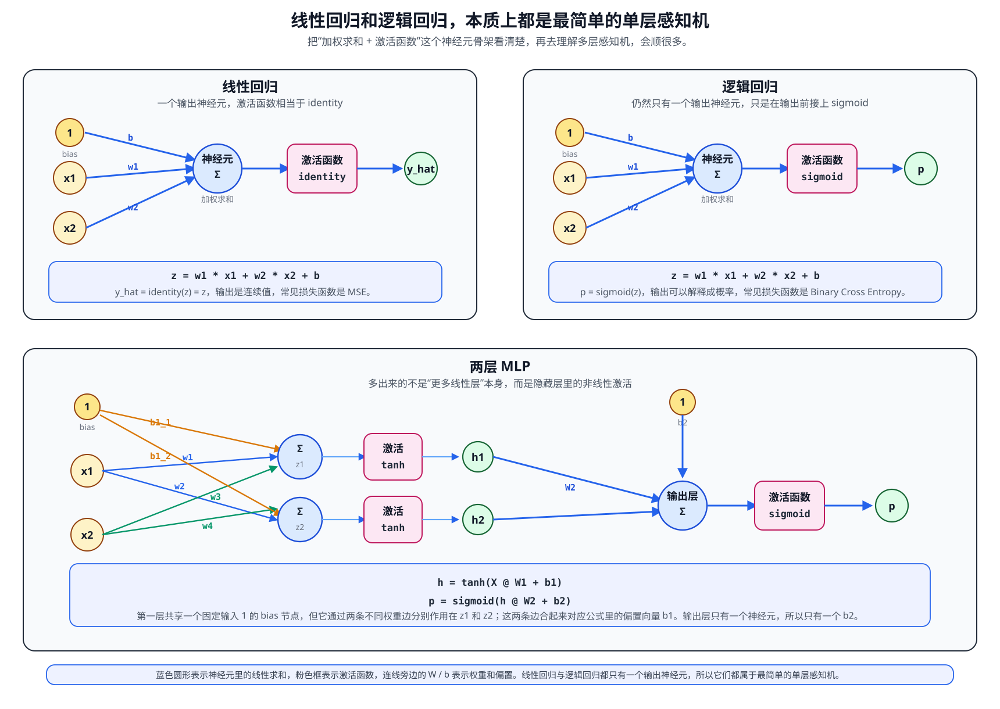
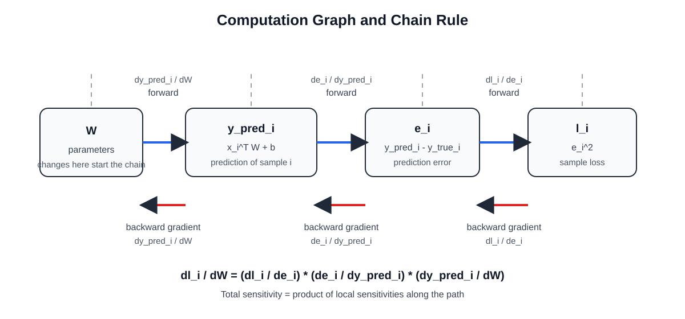
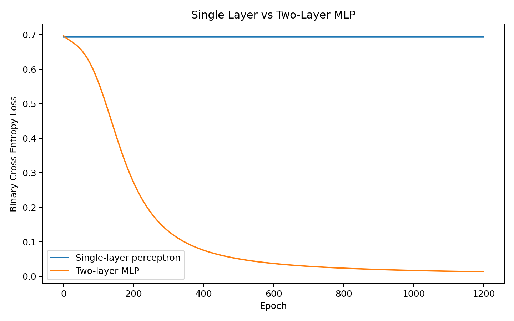
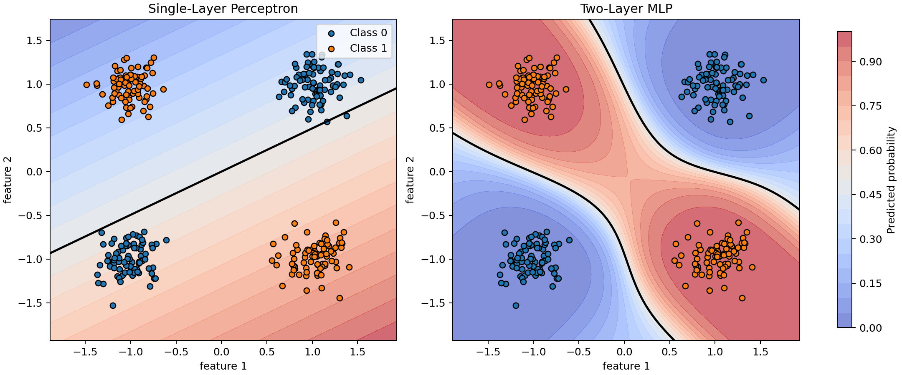
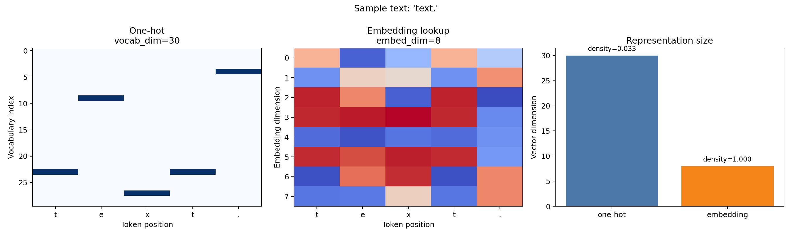
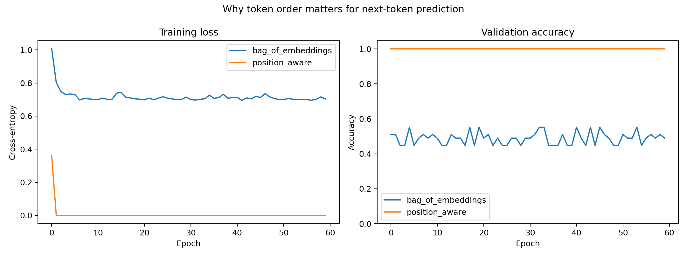

# 从线性回归到 Transformer

## 前言

前几天，一个朋友在知乎上刷到一个问题：**Transformer 里的 Q、K、V 到底是什么？**
他是 Deep Learning 零基础，看了不少高赞回答，还是觉得云里雾里。我回头看了那些答案，发现问题本身没有错，答案本身也没有错，但它们普遍有一个共同问题：**默认读者已经具备了不少前置知识。**

如果一个人还没有真正理解下面这些最基础的问题：

- 模型是什么
- 参数是什么
- loss 是什么
- 梯度为什么能更新参数
- 为什么会有链式法则
- 为什么分类问题常用交叉熵而不是 MSE

那他很难真正理解 Transformer，更别说 Q、K、V、self-attention、mask、multi-head 这些概念。

所以这篇文章不打算一上来就解释 Q、K、V，也不打算直接扔出一张 Transformer 结构图就结束。更自然的做法是沿着一条尽量连续的技术链条往前走：

`线性模型 -> 多层感知机 -> 反向传播与优化 -> 序列建模 -> 注意力机制 -> Transformer`

本文先把整条链条里最基础、但也最容易被略过的那一段讲扎实：**线性回归、逻辑回归、损失函数、梯度下降和链式法则。** 如果这些东西没有真正理解，后面的 MLP、attention 和 Transformer 往往就只能靠背。

---

## 这篇文章想回答什么

读完这篇文章，你至少应该能回答下面这些问题：

1. 线性回归到底在做什么，为什么它可以被视为很多神经网络的最小原型？
2. 逻辑回归和线性回归到底差在哪里，为什么前者自然地走向分类和概率建模？
3. MSE 是什么，交叉熵又是什么，为什么分类任务通常更偏爱交叉熵？
4. 为什么交叉熵里要有 `log`，这个 `log` 的底数默认是什么？
5. `dL/dW = (2 / N) * X^T @ (y_pred - y_true)` 这种公式是怎么来的，链式法则到底在做什么？
6. `@`、`X^T`、`X ∈ R^(N x d)` 这些记号分别是什么意思，它们在代码里对应什么操作？
7. 为什么梯度下降真的能让 loss 变小，学习率又在训练里扮演什么角色？
8. 为什么只有线性变换还不够，为什么多层感知机必须引入非线性激活函数？
9. 反向传播在多层网络里到底是如何展开的，它和前面看到的链式法则是什么关系？
10. 为什么处理文本和序列时，MLP 会开始变得笨拙，RNN/LSTM 又试图解决什么问题？
11. 注意力机制到底在解决什么痛点，Q、K、V 这三个量分别扮演什么角色？
12. Self-Attention 和传统序列模型相比到底改变了什么，为什么它能更好地并行计算？
13. Transformer 中的位置编码、多头注意力、残差连接、LayerNorm 分别在解决什么问题？
14. Encoder、Decoder、Encoder-Decoder 这几种结构各自适合什么任务，它们和 BERT、GPT 之间是什么关系？
15. 当我们最终回到最初的问题时，是否能够用一条连续的技术脉络解释：Transformer 为什么会出现，它究竟比之前的方法好在哪里？

---

## 从代码和线性模型开始

### 先说明配套仓库和阅读方式

这篇文章配套的代码仓库在这里：

[`Obscurepawn/llm-zero-to-one`](https://github.com/Obscurepawn/llm-zero-to-one)

建议把这篇文章和仓库一起看。阅读方式很简单：

- 正文负责解释“为什么”
- 仓库里的代码负责展示“怎么做”
- 图和实验输出负责帮你建立直觉

就这篇文章目前涉及的内容来说，最重要的代码目录是：

```text
experiments/linear-and-logistic-regression/
```

建议按下面这个顺序阅读：

1. 先看正文中当前小节讲的概念。
2. 再看仓库里的对应脚本，例如 `linear_regression_numpy.py` 和 `logistic_regression_numpy.py`。
3. 最后自己运行代码，观察 loss 曲线、拟合直线、分类边界和图像输出。

这篇文章不会把代码当作附录，而是把代码当作正文的一部分。很多概念只看文字容易觉得“好像懂了”，但一旦对照代码和图，就会发现自己其实并没有完全明白。

### 为什么要从线性模型开始

神经网络并不是凭空出现的。你今天看到的 MLP、RNN、Transformer，本质上都在回答同一个问题：

> 给定输入，如何通过一组可学习参数，得到更接近真实答案的输出？

线性回归和逻辑回归是这个问题最简单的两个版本。

- 线性回归告诉你：如果目标是连续值，怎么做建模。
- 逻辑回归告诉你：如果目标是类别，怎么把线性模型改成概率模型。

这两个模型虽然简单，但已经包含了后面所有深度学习模型的骨架：

- 输入
- 参数
- 前向计算
- 损失函数
- 梯度
- 参数更新

理解了这两个模型，再去看 MLP 和反向传播，很多东西就不会显得神秘。

---

### 线性回归

#### 线性回归在做什么

线性回归解决的是**回归问题**，也就是预测一个连续数值。

例如：

- 根据面积预测房价
- 根据气温、湿度预测用电量
- 根据广告投入预测销量

最简单的一元线性回归公式是：

$$
y = wx + b
$$

这里：

- `x` 是输入
- `w` 是权重
- `b` 是偏置
- `y` 是预测值

如果样本不止一个，或者特征不止一个，通常会写成矩阵形式：

$$
y_{\text{pred}} = XW + b
$$

这就是代码里写的：

```python
return x @ weight + bias
```

为了和下面这张神经网络结构图里的符号一一对应，可以先把“两个输入特征”的展开形式写出来：

```text
z = w1 * x1 + w2 * x2 + b
y_hat = z
```

这时图里的符号就是：

- `x1`、`x2`：两个输入特征
- `w1`、`w2`：对应权重
- `b`：偏置
- `z`：线性求和结果
- `y_hat`：最终输出

如果把这几个标量重新收回矩阵形式，就回到了上面的 `y_pred = XW + b`。

下面这张图使用的是“线性回归、逻辑回归、两层 MLP”放在一起的对比结构图。当前这里先看左上角的线性回归部分：它只有一次加权求和，最后直接输出一个连续值。



#### 读懂几个最基本的数学记号

刚接触机器学习时，最容易被这些记号绊住。这里一次性解释清楚。

##### `X ∈ R^(N x d)` 是什么意思

这句话读作：

> `X` 属于实数域上的 `N x d` 矩阵

翻译成人话就是：

- `X` 是一个矩阵
- 它有 `N` 行、`d` 列
- 里面的元素都是普通实数

在机器学习里，通常这样理解：

- `N` 表示样本数
- `d` 表示特征维度

所以：

$$
X \in \mathbb{R}^{N \times d}
$$

通常表示“有 `N` 个样本，每个样本有 `d` 个特征”。

##### 当前这个例子里，`d` 是多少

在本文的线性回归实验里，输入数据是这样生成的：

```python
x = rng.uniform(-2.0, 2.0, size=(num_samples, 1))
```

所以：

- `x.shape = (N, 1)`
- 这意味着当前例子里 `d = 1`

也就是说，这是一元线性回归：每个样本只有 1 个特征。

##### `@` 是什么意思

在 Python 和 NumPy 里：

- `*` 表示逐元素乘法
- `@` 表示矩阵乘法

所以：

```python
X @ W
```

不是简单地“按位置相乘”，而是线性代数里的矩阵乘法。

如果：

- `X.shape = (N, d)`
- `W.shape = (d, 1)`

那么：

$$
XW \rightarrow (N, 1)
$$

这正好得到 `N` 个样本各自的预测值。

##### `X^T` 是什么意思

`X^T` 表示 `X` 的**转置**，也就是把行和列交换。

如果：

$$
X \in \mathbb{R}^{N \times d}
$$

那么：

$$
X^T \in \mathbb{R}^{d \times N}
$$

它会在梯度公式里出现：

$$
\frac{\partial L}{\partial W} = \frac{2}{N} X^T (y_{\text{pred}} - y_{\text{true}})
$$

这里只说“shape 对齐”还是有点抽象，可以拆开来看。

先记住三件事：

- `X` 是按样本排的矩阵，shape 是 `(N, d)`
- `error = y_pred - y_true`，shape 是 `(N, 1)`
- `W` 是权重，shape 是 `(d, 1)`

我们现在要求的是 `W` 的梯度，所以最后算出来的结果也必须是 `(d, 1)`。

如果你不转置，直接写：

$$
X \, \text{error}
$$

那么维度会变成：

$$
(N, d) \times (N, 1)
$$

这在矩阵乘法里根本乘不起来，因为中间那两个维度不相等。

但如果先转置：

```text
X^T @ error
```

维度就变成：

$$
(d, N) \times (N, 1) \rightarrow (d, 1)
$$

这时结果的 shape 正好就和 `W` 一样了。

如果再看一个具体例子，会更直观。假设有 3 个样本、2 个特征：

$$
X =
\begin{bmatrix}
x_{11} & x_{12} \\
x_{21} & x_{22} \\
x_{31} & x_{32}
\end{bmatrix}
$$

那么：

$$
X^T =
\begin{bmatrix}
x_{11} & x_{21} & x_{31} \\
x_{12} & x_{22} & x_{32}
\end{bmatrix}
$$

如果误差向量是：

$$
\text{error} =
\begin{bmatrix}
e_1 \\
e_2 \\
e_3
\end{bmatrix}
$$

那么：

$$
X^T \, \text{error}
=
\begin{bmatrix}
x_{11} e_1 + x_{21} e_2 + x_{31} e_3 \\
x_{12} e_1 + x_{22} e_2 + x_{32} e_3
\end{bmatrix}
$$

你可以把它理解成：

- 第一行在汇总“第 1 个特征”对总误差的贡献
- 第二行在汇总“第 2 个特征”对总误差的贡献

最后就得到两个数，正好分别对应两个权重的梯度。所以这里转置不是形式上的技巧，而是在把“按样本组织的数据”变成“按特征汇总误差贡献”的视角。

---

#### 数据是怎么生成出来的

本文的线性回归示例使用了下面这段代码来造数据：

```python
def make_regression_data(
    num_samples: int = 120,
    true_weight: float = 4.0,
    true_bias: float = 7.0,
    noise_std: float = 1.2,
    seed: int = 42,
) -> tuple[np.ndarray, np.ndarray]:
    rng = np.random.default_rng(seed)

    x = rng.uniform(-2.0, 2.0, size=(num_samples, 1))
    noise = rng.normal(loc=0.0, scale=noise_std, size=(num_samples, 1))
    y = true_weight * x + true_bias + noise
    return x, y
```

这段代码里最容易让初学者困惑的是这几项：

##### `rng` 是什么

`rng` 是随机数生成器，来自：

```python
rng = np.random.default_rng(seed)
```

它负责随机生成数据。这里设置了 `seed`，是为了保证每次运行都能得到同样的随机结果，便于复现。

##### `x` 是什么

`x` 是输入特征，也就是线性回归里的自变量。

```python
x = rng.uniform(-2.0, 2.0, size=(num_samples, 1))
```

这句话的意思是：

- 在 `[-2, 2]` 区间内随机采样
- 一共生成 `num_samples` 个样本
- 每个样本只有 1 个特征

所以 `x` 的 shape 是 `(num_samples, 1)`。

##### `noise` 是什么

`noise` 是噪声项：

```python
noise = rng.normal(loc=0.0, scale=noise_std, size=(num_samples, 1))
```

它的作用是让数据更接近真实世界。现实里的数据通常不会完美落在一条直线上，所以我们故意加入一点随机扰动。

##### `rng.uniform` 是什么意思

`rng.uniform(a, b, size=...)` 表示从**均匀分布**里采样。

```python
rng.uniform(-2.0, 2.0, size=(num_samples, 1))
```

就是在 `[-2, 2]` 这个区间里随机取数，每个位置被取到的机会差不多一样。

##### `rng.normal` 是什么意思

`rng.normal(loc=0.0, scale=noise_std, size=...)` 表示从**正态分布**里采样。

这里：

- `loc=0.0` 表示均值为 0
- `scale=noise_std` 表示标准差为 `noise_std`

所以我们最终得到的数据是：

$$
y = 4x + 7 + \text{noise}
$$

这相当于先定义一条真实直线，再给每个样本加一点扰动。

---

#### 线性回归是不是就是最小二乘法

如果你学过高中里“给一堆散点拟合一条直线”，那你其实已经见过线性回归最经典的原型了。

最常见的做法是：给定很多点，找一条直线

$$
y = wx + b
$$

让它尽量贴近这些点。这里“贴近”的常见定义，就是让所有点到直线的纵向误差平方和最小，也就是：

$$
\min \sum_i \left(y_i - (w x_i + b)\right)^2
$$

这就是最小二乘法。这里的“二乘”指的就是平方。

所以如果只讨论最经典的一元线性回归，那么完全可以先把它理解成：

> 线性回归本质上就是高中数学里常见的最小二乘拟合直线。

不过更严格一点地说，还是要区分两个层面：

- **线性回归**是模型
- **最小二乘法**是拟合这个模型的一种目标或方法

线性回归描述的是模型形式：

$$
y = XW + b
$$

最小二乘描述的是训练目标：

$$
\text{让 } \sum \left(y_{\text{true}} - y_{\text{pred}}\right)^2 \text{ 尽可能小}
$$

所以更准确地说，应该是：

> 线性回归通常通过最小二乘法来拟合

如果你用的是均方误差 `MSE`，那本质上就是在做最小二乘。

---

#### MSE 是什么

`MSE` 是 `Mean Squared Error`，中文叫**均方误差**：

$$
\mathrm{MSE} = \operatorname{mean}\left(\left(y_{\text{true}} - y_{\text{pred}}\right)^2\right)
$$

为什么要平方？

- 正负误差不会互相抵消
- 大误差会被放大
- 对连续值回归来说，这个定义非常自然

代码里的实现就是：

```python
def mean_squared_error(y_true: np.ndarray, y_pred: np.ndarray) -> float:
    return float(np.mean((y_true - y_pred) ** 2))
```

---

#### 梯度下降视角下的训练流程

线性回归训练的核心流程其实只有四步：

1. 前向计算：根据当前参数做预测
2. 计算损失：看看预测值离真实值有多远
3. 计算梯度：求参数往哪个方向改，loss 才会下降
4. 更新参数：把参数朝梯度反方向推一步

对应到代码里就是：

```python
for epoch in range(epochs):
    y_pred = predict(x, weight, bias)
    loss = mean_squared_error(y, y_pred)
    d_weight, d_bias = compute_gradients(x, y, y_pred)

    weight -= learning_rate * d_weight
    bias -= learning_rate * d_bias
```

这里最重要的一句是：

```python
weight -= learning_rate * d_weight
```

为什么是减号？因为：

- 梯度指向的是 loss 增长最快的方向
- 我们想让 loss 下降
- 所以更新时应该沿着梯度的反方向走

---

#### 梯度公式为什么是这个样子

代码里的梯度计算是：

```python
num_samples = x.shape[0]
error = y_pred - y_true
d_weight = (2.0 / num_samples) * (x.T @ error)
d_bias = float((2.0 / num_samples) * np.sum(error))
```

它对应的数学公式是：

$$
\frac{\partial L}{\partial W}
=
\frac{\partial L}{\partial e}
\frac{\partial e}{\partial y_{\text{pred}}}
\frac{\partial y_{\text{pred}}}{\partial W}
=
\frac{2}{N} X^T \left(y_{\text{pred}} - y_{\text{true}}\right)
$$

$$
\frac{\partial L}{\partial b}
=
\frac{\partial L}{\partial e}
\frac{\partial e}{\partial y_{\text{pred}}}
\frac{\partial y_{\text{pred}}}{\partial b}
=
\frac{2}{N} \sum \left(y_{\text{pred}} - y_{\text{true}}\right)
$$

接下来我们完整推导一遍。

##### 先定义单样本损失

对第 `i` 个样本，定义：

$$
y_{\text{pred},i} = x_i^T W + b
$$

$$
e_i = y_{\text{pred},i} - y_{\text{true},i}
$$

$$
\ell_i = e_i^2
$$

于是：

$$
\ell_i = \left(y_{\text{pred},i} - y_{\text{true},i}\right)^2
$$

##### 为什么这里会出现链式法则

因为 `l_i` 不是直接由 `W` 算出来的，而是通过中间变量一层层依赖：

$$
W \rightarrow y_{\text{pred},i} \rightarrow e_i \rightarrow \ell_i
$$

也就是说：

- `W` 先影响预测值 `y_pred_i`
- `y_pred_i` 再影响误差 `e_i`
- `e_i` 最后影响损失 `l_i`

把它完全展开，`\ell_i` 实际上是一个套娃函数：

$$
\ell_i(W) = \left(\left[x_i^T W + b\right] - y_{\text{true},i}\right)^2
$$

链式法则正是用来处理这种“间接依赖”的。

##### 为什么链式法则会写成乘法

先看最简单的两层函数：

$$
z = f(y), \quad y = g(x)
$$

当 `x` 发生一点微小变化 `dx` 时：

$$
dy \approx \frac{dy}{dx} dx
$$

$$
dz \approx \frac{dz}{dy} dy
$$

把第二式里的 `dy` 用第一式代换掉：

$$
dz \approx \frac{dz}{dy} \frac{dy}{dx} dx
$$

所以：

$$
\frac{dz}{dx} = \frac{dz}{dy} \frac{dy}{dx}
$$

这就是最基本的链式法则。

如果中间再多一层：

$$
\ell = h(e), \quad e = g(y), \quad y = f(W)
$$

同样可以得到：

$$
\frac{d\ell}{dW} = \frac{d\ell}{de} \frac{de}{dy} \frac{dy}{dW}
$$

翻译成这道题里的变量，就是：

$$
\frac{\partial \ell_i}{\partial W}
=
\frac{\partial \ell_i}{\partial e_i}
\frac{\partial e_i}{\partial y_{\text{pred},i}}
\frac{\partial y_{\text{pred},i}}{\partial W}
$$

也就是说：

> 总变化率 = 路径上每一段局部变化率的乘积

##### 为什么对向量 `W` 也成立

严格地说，`W` 不是一个标量，而是一个向量：

$$
W = [w_1, w_2, \dots, w_d]^T
$$

所以你也可以先对每个分量分别看：

$$
\frac{\partial \ell_i}{\partial w_j}
=
\frac{\partial \ell_i}{\partial e_i}
\frac{\partial e_i}{\partial y_{\text{pred},i}}
\frac{\partial y_{\text{pred},i}}{\partial w_j}
$$

这对每个 `w_j` 都成立。

然后把所有分量的偏导数收集起来，就得到整个梯度向量：

$$
\frac{\partial \ell_i}{\partial W}
$$

所以向量情形并没有推翻链式法则，它只是把“对每个分量分别应用链式法则”再合并起来。

##### 计算图直觉

下面这张图把“正向计算”和“反向传导梯度”放到了一起：



读图时抓住两件事就够了：

- 正向计算时，值沿着 `W -> y_pred_i -> e_i -> l_i` 往前走
- 反向求梯度时，敏感度沿着 `l_i -> e_i -> y_pred_i -> W` 往回传

所以反向传播并不神秘，它本质上就是把链式法则系统化地应用在计算图上。

##### 正式推导 `∂l_i / ∂W`

因为：

$$
\ell_i = e_i^2, \quad e_i = y_{\text{pred},i} - y_{\text{true},i}, \quad y_{\text{pred},i} = x_i^T W + b
$$

所以：

$$
\frac{\partial \ell_i}{\partial W}
=
\frac{\partial \ell_i}{\partial e_i}
\frac{\partial e_i}{\partial y_{\text{pred},i}}
\frac{\partial y_{\text{pred},i}}{\partial W}
$$

逐项求：

$$
\frac{\partial \ell_i}{\partial e_i} = 2e_i,\quad
\frac{\partial e_i}{\partial y_{\text{pred},i}} = 1,\quad
\frac{\partial y_{\text{pred},i}}{\partial W} = x_i
$$

连起来得到：

$$
\frac{\partial \ell_i}{\partial W} = 2 e_i \cdot 1 \cdot x_i = 2 e_i x_i
$$

代回 `e_i = y_{\text{pred},i} - y_{\text{true},i}`：

$$
\frac{\partial \ell_i}{\partial W} = 2 \left(y_{\text{pred},i} - y_{\text{true},i}\right) x_i
$$

##### 再推导 `∂l_i / ∂b`

同理：

$$
\frac{\partial \ell_i}{\partial b}
=
\frac{\partial \ell_i}{\partial e_i}
\frac{\partial e_i}{\partial y_{\text{pred},i}}
\frac{\partial y_{\text{pred},i}}{\partial b}
$$

其中：

$$
\frac{\partial y_{\text{pred},i}}{\partial b} = 1
$$

所以：

$$
\frac{\partial \ell_i}{\partial b} = 2 e_i = 2 \left(y_{\text{pred},i} - y_{\text{true},i}\right)
$$

##### 从单样本推广到全部样本

总体损失：

$$
L = \frac{1}{N} \sum_i \ell_i
$$

所以：

$$
\frac{\partial L}{\partial W}
= \frac{1}{N} \sum_i \frac{\partial \ell_i}{\partial W}
= \frac{1}{N} \sum_i \left(\frac{\partial \ell_i}{\partial e_i}
\frac{\partial e_i}{\partial y_{\text{pred},i}}
\frac{\partial y_{\text{pred},i}}{\partial W}\right)
= \frac{2}{N} \sum_i e_i x_i
$$

$$
\frac{\partial L}{\partial b}
= \frac{1}{N} \sum_i \frac{\partial \ell_i}{\partial b}
= \frac{1}{N} \sum_i \left(\frac{\partial \ell_i}{\partial e_i}
\frac{\partial e_i}{\partial y_{\text{pred},i}}
\frac{\partial y_{\text{pred},i}}{\partial b}\right)
= \frac{2}{N} \sum_i e_i
$$

再写成矩阵形式：

$$
\text{error} = y_{\text{pred}} - y_{\text{true}}
$$

则：

$$
\frac{\partial L}{\partial W}
= \frac{2}{N} X^T \, \text{error}
= \frac{2}{N} X^T \left(y_{\text{pred}} - y_{\text{true}}\right)
$$

$$
\frac{\partial L}{\partial b}
= \frac{2}{N} \sum \text{error}
= \frac{2}{N} \sum \left(y_{\text{pred}} - y_{\text{true}}\right)
$$

这就是代码里那两行梯度公式的来源。

##### `X^T @ error` 直觉上到底在做什么

这一项很值得单独看一眼：

$$
X^T \, \text{error}
$$

如果：

- `X.shape = (N, d)`
- `X^T.shape = (d, N)`
- `error.shape = (N, 1)`

那么：

```text
(d, N) @ (N, 1) -> (d, 1)
```

结果 shape 正好和 `W` 一样。

更重要的是，它在数学上等价于：

$$
X^T \, \text{error} = \sum_i e_i x_i
$$

也就是说：

- 每个样本都会贡献一份 `误差 × 特征`
- 然后这些贡献在每个特征维度上被汇总起来
- 最终形成“每个权重该怎么改”的总方向

你可以把它理解成：

> `X` 是按样本组织数据，`X^T` 则把视角切换成“按特征汇总误差贡献”

---

#### 学习率到底影响了什么

下面这张图来自线性回归实验中三个学习率的对比：


这张图很适合建立学习率直觉：

- `lr=0.01`：能降，但很慢
- `lr=0.05`：下降速度和稳定性都比较好
- `lr=0.8`：在这个例子里也能收敛，但前期震荡更明显

需要强调的是，`0.8` 在这里还能工作，不代表大学习率总是安全。换一个数据分布或初始化方式，它就可能直接发散。

##### 这张图对应的实验设置

代码里设置的是：

```python
learning_rates = [0.01, 0.05, 0.80]
epochs = 120
```

运行日志的关键结果是：

- `lr=0.01` 最终 loss 约为 `1.93`
- `lr=0.05` 最终 loss 约为 `1.46`
- `lr=0.80` 最终 loss 也收敛到约 `1.46`

这说明学习率确实会显著影响收敛速度。

---

#### 拟合结果长什么样

除了看 loss 曲线，另一个更直观的问题是：模型学出来的直线到底像不像数据本身？


这张图展示了：

- 散点：训练数据
- 红线：模型学到的拟合结果

在这组实验里，最终学到的参数大致是：

$$
w \approx 3.996,\quad b \approx 6.989
$$

而生成数据时的真实参数是：

$$
\text{true\_weight} = 4.0,\quad \text{true\_bias} = 7.0
$$

这说明线性回归已经把真实关系学得相当接近了。

---

#### 本节最关键的结论

学完线性回归之后，你至少要真正理解三件事：

1. 模型的本质是：输入经过参数变换得到输出
2. 训练的本质是：通过梯度不断调整参数，让 loss 下降
3. 链式法则不是抽象公式，而是“影响沿依赖路径逐层传递”的规则

---

### 逻辑回归

#### 逻辑回归和线性回归的区别是什么

最核心的一句话：

> 线性回归预测连续数值，逻辑回归预测类别概率。

更具体一点：

- 线性回归输出任意实数，适合房价、温度、销量这类回归任务
- 逻辑回归输出 `0` 到 `1` 之间的概率，适合二分类任务

你也可以把逻辑回归记成：

$$
\text{逻辑回归} = \text{线性模型} + \sigma + \text{交叉熵}
$$

##### 一个更清楚的对比

| 项目 | 线性回归 | 逻辑回归 |
| --- | --- | --- |
| 任务类型 | 回归 | 二分类 |
| 输出 | 连续数值 | 概率 |
| 前向形式 | `XW + b` | `sigmoid(XW + b)` |
| 常见损失 | MSE | Binary Cross Entropy |
| 最终结果 | 一个实数 | 一个类别概率，再阈值化 |

---

#### 为什么逻辑回归能做分类

为了和图里的中间一栏完全对应，先把二维特征版写开：

```text
z = w1 * x1 + w2 * x2 + b
p = sigmoid(z)
```

这里图里的 `x1`、`x2`、`w1`、`w2`、`b`、`z`、`p` 和上面两行是一一对应的。

如果重新收回矩阵形式，逻辑回归先做一次线性变换：

$$
z = XW + b
$$

然后再过一个 `sigmoid`：

$$
p = \sigma(z) = \frac{1}{1 + e^{-z}}
$$

这样输出 `p` 就会落在 `0` 到 `1` 之间，可以解释为“属于正类的概率”。

下面这张图还是同一张对比结构图。当前这里看右上角的逻辑回归部分：它和线性回归的差别，只是在最后多了一个 `sigmoid`。


对应代码是：

```python
def sigmoid(z: np.ndarray) -> np.ndarray:
    z = np.clip(z, -500.0, 500.0)
    return 1.0 / (1.0 + np.exp(-z))


def predict_proba(x: np.ndarray, weight: np.ndarray, bias: float) -> np.ndarray:
    linear_output = x @ weight + bias
    return sigmoid(linear_output)
```

如果最后再加一个阈值，比如 `0.5`：

- `p >= 0.5` 判为 1
- `p < 0.5` 判为 0

就得到了最终分类结果。

---

#### 交叉熵是什么

交叉熵可以先粗暴理解成一句话：

> 它衡量的是：模型给正确答案分配了多少概率。

如果模型把很高的概率给了正确类别，交叉熵就小；如果模型很自信地猜错了，交叉熵就会很大。

在二分类里，常见形式是：

$$
L = -\bigl[y \log(p) + (1-y)\log(1-p)\bigr]
$$

这里：

- `y` 是真实标签，只能是 `0` 或 `1`
- `p` 是模型预测“属于 1 类”的概率

这会自动分成两种情况：

如果 `y = 1`：

$$
L = -\log(p)
$$

如果 `y = 0`：

$$
L = -\log(1-p)
$$

所以逻辑非常直接：

- 真实是 1，就希望 `p` 尽量大
- 真实是 0，就希望 `p` 尽量小

---

#### 为什么交叉熵里要有 `log`

这个问题非常关键。

你当然可以定义别的 loss，比如真实标签是 `1` 时，直接用：

$$
L = 1 - p
$$

它也能工作，但通常不如交叉熵好，主要有两个原因。

##### 原因 1：它对“自信但错误”的预测惩罚不够重

假设真实标签是 `1`：

- 如果 `p = 0.9`，那么 `1 - p = 0.1`
- 如果 `p = 0.1`，那么 `1 - p = 0.9`
- 如果 `p = 0.001`，那么 `1 - p = 0.999`

可以看到，`0.1` 和 `0.001` 虽然差得非常大，但 loss 变化不够明显。

而交叉熵：

$$
-\log(0.9) \approx 0.105,\quad -\log(0.1) \approx 2.303,\quad -\log(0.001) \approx 6.908
$$

这就合理得多：错得越离谱，惩罚越大。

##### 原因 2：交叉熵配合 sigmoid 时，梯度更适合优化

逻辑回归里如果把输出写成 `p = sigmoid(z)`，那么交叉熵对 `z` 的梯度会简化成：

$$
\frac{dL}{dz}
=
\frac{dL}{dp}\frac{dp}{dz}
= p - y
$$

这非常干净：

- 如果真实是 `1`，但模型给了很小的 `p`，梯度会推动参数快速修正
- 如果真实是 `0`，但模型给了很大的 `p`，梯度也会强烈推动参数往回拉

所以交叉熵不是随便造出来的，它和概率建模、最大似然估计是配套的。

---

#### 这里的 `log` 底数是什么

在机器学习和深度学习里，交叉熵中的：

$$
\log(p)
$$

默认通常是**自然对数**，也就是以 `e` 为底：

$$
\log(p) = \ln(p) = \log_e(p)
$$

在 NumPy 和 PyTorch 里：

- `np.log(x)` 是自然对数
- `torch.log(x)` 也是自然对数

如果你换成别的底数，也不是不行，但本质上只是让 loss 多了一个常数比例，不会改变最优点。

---

#### MSE 和交叉熵的区别

一句话记忆：

> MSE 管数值误差，交叉熵管概率分配。

更具体一点：

- `MSE` 适合回归任务，因为目标本来就是连续数值
- `交叉熵` 适合分类任务，因为模型输出的是概率

所以在逻辑回归里，我们通常不再使用 MSE，而是使用二元交叉熵：

```python
def binary_cross_entropy(y_true: np.ndarray, y_prob: np.ndarray) -> float:
    epsilon = 1e-8
    y_prob = np.clip(y_prob, epsilon, 1.0 - epsilon)
    loss = -np.mean(y_true * np.log(y_prob) + (1.0 - y_true) * np.log(1.0 - y_prob))
    return float(loss)
```

这里的 `np.clip` 是为了避免：

- `log(0)` 这种数值问题
- 概率刚好等于 `0` 或 `1` 时出现溢出

---

#### 逻辑回归的梯度和线性回归有什么联系

逻辑回归在交叉熵损失下的梯度是：

$$
\frac{\partial L}{\partial W}
=
\frac{\partial L}{\partial z}\frac{\partial z}{\partial W}
= \frac{1}{N} X^T \left(y_{\text{prob}} - y_{\text{true}}\right)
$$

$$
\frac{\partial L}{\partial b}
=
\frac{\partial L}{\partial z}\frac{\partial z}{\partial b}
= \frac{1}{N} \sum \left(y_{\text{prob}} - y_{\text{true}}\right)
$$

你会发现它和线性回归非常像：

线性回归：

$$
\frac{\partial L}{\partial W}
=
\frac{\partial L}{\partial y_{\text{pred}}}\frac{\partial y_{\text{pred}}}{\partial W}
= \frac{2}{N} X^T \left(y_{\text{pred}} - y_{\text{true}}\right)
$$

$$
\frac{\partial L}{\partial b}
=
\frac{\partial L}{\partial y_{\text{pred}}}\frac{\partial y_{\text{pred}}}{\partial b}
= \frac{2}{N} \sum \left(y_{\text{pred}} - y_{\text{true}}\right)
$$

逻辑回归：

$$
\frac{\partial L}{\partial W}
=
\frac{\partial L}{\partial z}\frac{\partial z}{\partial W}
= \frac{1}{N} X^T \left(y_{\text{prob}} - y_{\text{true}}\right)
$$

$$
\frac{\partial L}{\partial b}
=
\frac{\partial L}{\partial z}\frac{\partial z}{\partial b}
= \frac{1}{N} \sum \left(y_{\text{prob}} - y_{\text{true}}\right)
$$

两者结构高度一致，差别主要在于：

- 线性回归的误差项是连续值误差 `y_pred - y_true`
- 逻辑回归的误差项是概率误差 `y_prob - y_true`

对应代码是：

```python
def compute_gradients(
    x: np.ndarray,
    y_true: np.ndarray,
    y_prob: np.ndarray,
) -> tuple[np.ndarray, float]:
    num_samples = x.shape[0]
    error = y_prob - y_true
    d_weight = (x.T @ error) / num_samples
    d_bias = float(np.sum(error) / num_samples)
    return d_weight, d_bias
```

---

#### 逻辑回归实验看什么

本文的逻辑回归实验使用二维数据，是为了让分类边界可以被直观画出来。

下面这张图展示了训练后的分类边界：


你可以这样理解这张图：

- 每个点是一个样本
- 不同颜色代表不同类别
- 黑线是模型学到的决策边界

在二维情况下，逻辑回归的边界满足：

$$
w_1 x_1 + w_2 x_2 + b = 0
$$

所以它是一条直线。

下面是不同学习率下的交叉熵下降曲线：


这个实验说明：

- 逻辑回归和线性回归一样，也依赖学习率
- 标准化输入特征后，训练通常会更稳定
- 分类任务里的 loss 下降曲线和回归任务的形状可能不同，但背后的优化逻辑完全一致

在这组实验里，最终分类准确率大约是：

$$
\text{accuracy} \approx 99.58\%
$$

---

### 几个容易卡住的细节

#### `x` 和 `noise` 到底是什么

在线性回归数据生成函数里：

```python
x = rng.uniform(-2.0, 2.0, size=(num_samples, 1))
noise = rng.normal(loc=0.0, scale=noise_std, size=(num_samples, 1))
```

- `x` 是输入特征
- `noise` 是人为加入的随机误差

最终标签是：

$$
y = \text{true\_weight} \cdot x + \text{true\_bias} + \text{noise}
$$

也就是“真实直线关系 + 扰动”。

#### `@` 能不能理解成乘法

可以，但要更准确地说：它是**矩阵乘法**。

- `*` 是逐元素乘法
- `@` 是矩阵乘法

在这篇文章的代码里，`X @ W` 就是在实现线性模型的前向计算。

#### `X^T` 是什么

`X^T` 是 `X` 的转置，也就是把行和列交换。

它在梯度公式里出现，是因为我们要把“按样本组织的误差”汇总成“按特征组织的梯度”。

#### 当前例子里 `d` 是不是 1

是的，线性回归这个实验里：

```python
x.shape = (num_samples, 1)
```

所以当前这个 case 里，`d = 1`。

逻辑回归那个实验里，每个样本有 2 个特征，所以那里 `d = 2`。

#### 线性回归听起来是不是就是最小二乘法

可以这么理解，但更准确的说法是：

> 线性回归是模型，最小二乘法是训练它的一种经典方式。

#### 交叉熵里的 `log` 默认是什么底

默认是自然对数，也就是底数为 `e`。

在代码里：

```python
np.log(x)
```

就是自然对数。

---

### 配套代码

为了不把正文写成大段脚本清单，文中配套实验代码放在仓库目录：

```text
experiments/linear-and-logistic-regression/
```

对应文件包括：

- `linear_regression_numpy.py`
- `logistic_regression_numpy.py`
- `linear_regression_gradient_derivation.md`
- `run_all.py`

下面把核心代码整理到本文里。

#### 线性回归核心代码

```python
def make_regression_data(
    num_samples: int = 120,
    true_weight: float = 4.0,
    true_bias: float = 7.0,
    noise_std: float = 1.2,
    seed: int = 42,
) -> tuple[np.ndarray, np.ndarray]:
    rng = np.random.default_rng(seed)
    x = rng.uniform(-2.0, 2.0, size=(num_samples, 1))
    noise = rng.normal(loc=0.0, scale=noise_std, size=(num_samples, 1))
    y = true_weight * x + true_bias + noise
    return x, y


def predict(x: np.ndarray, weight: np.ndarray, bias: float) -> np.ndarray:
    return x @ weight + bias


def mean_squared_error(y_true: np.ndarray, y_pred: np.ndarray) -> float:
    return float(np.mean((y_true - y_pred) ** 2))


def compute_gradients(
    x: np.ndarray,
    y_true: np.ndarray,
    y_pred: np.ndarray,
) -> tuple[np.ndarray, float]:
    num_samples = x.shape[0]
    error = y_pred - y_true
    d_weight = (2.0 / num_samples) * (x.T @ error)
    d_bias = float((2.0 / num_samples) * np.sum(error))
    return d_weight, d_bias


def train_linear_regression(
    x: np.ndarray,
    y: np.ndarray,
    learning_rate: float,
    epochs: int,
) -> dict[str, np.ndarray | float | list[float]]:
    weight = np.zeros((x.shape[1], 1))
    bias = 0.0
    loss_history: list[float] = []

    for epoch in range(epochs):
        y_pred = predict(x, weight, bias)
        loss = mean_squared_error(y, y_pred)
        loss_history.append(loss)

        d_weight, d_bias = compute_gradients(x, y, y_pred)

        weight -= learning_rate * d_weight
        bias -= learning_rate * d_bias

    return {
        "weight": weight,
        "bias": bias,
        "loss_history": loss_history,
        "final_predictions": predict(x, weight, bias),
    }
```

#### 逻辑回归核心代码

```python
def sigmoid(z: np.ndarray) -> np.ndarray:
    z = np.clip(z, -500.0, 500.0)
    return 1.0 / (1.0 + np.exp(-z))


def predict_proba(x: np.ndarray, weight: np.ndarray, bias: float) -> np.ndarray:
    linear_output = x @ weight + bias
    return sigmoid(linear_output)


def binary_cross_entropy(y_true: np.ndarray, y_prob: np.ndarray) -> float:
    epsilon = 1e-8
    y_prob = np.clip(y_prob, epsilon, 1.0 - epsilon)
    loss = -np.mean(y_true * np.log(y_prob) + (1.0 - y_true) * np.log(1.0 - y_prob))
    return float(loss)


def compute_gradients(
    x: np.ndarray,
    y_true: np.ndarray,
    y_prob: np.ndarray,
) -> tuple[np.ndarray, float]:
    num_samples = x.shape[0]
    error = y_prob - y_true
    d_weight = (x.T @ error) / num_samples
    d_bias = float(np.sum(error) / num_samples)
    return d_weight, d_bias


def predict_label(y_prob: np.ndarray, threshold: float = 0.5) -> np.ndarray:
    return (y_prob >= threshold).astype(np.int32)
```

#### 如何运行

如果你在本地仓库里复现本文的实验，可以在 `experiments/linear-and-logistic-regression/` 目录下执行：

```bash
python linear_regression_numpy.py
python logistic_regression_numpy.py
```

如果你想一次跑完：

```bash
python run_all.py
```

---

### 这一部分应该抓住什么

读到这里，你不需要立刻会写复杂的深度学习框架代码，但下面这些事情最好已经真正想清楚了：

1. 模型就是“输入经过参数变换得到输出”的函数。
2. 损失函数就是衡量“预测和真实差多少”的指标。
3. 梯度告诉你：参数往哪个方向改，loss 会下降。
4. 链式法则说明了：如果变量之间是间接依赖，影响就要沿依赖路径逐层传递。
5. 线性回归适合回归任务，逻辑回归适合二分类任务。
6. MSE 更适合连续值，交叉熵更适合概率分类。
7. 学习率不是越大越好，也不是越小越稳就越好，而是要平衡收敛速度和稳定性。

如果这些点你都能用自己的话讲清楚，那么线性模型这部分就算打稳了。

---

### 两层感知机和反向传播

#### 为什么还要从单层走到两层

如果只保留一层线性变换，再接一个 sigmoid，那么模型本质上还是线性分类器。它学到的是一条直线，或者在更高维空间里的一张超平面。

但很多数据不是线性可分的。最经典的例子就是 XOR：

- 左下和右上是一类
- 左上和右下是一类

这种数据无法用一条直线分开，所以单层模型会碰壁。两层感知机的意义就在这里：

> 中间多一层隐藏层，再插入一个非线性激活函数，模型就不再只是“线性函数套线性函数”，而是能表达弯曲的决策边界。

本文对应的实验代码在这里：

```text
experiments/mlp-and-backpropagation/mlp_numpy.py
```

这份代码里的两层网络结构是：

```text
X -> Linear -> Tanh -> Linear -> Sigmoid
```

也就是说：

- 第一层先把原始输入加工成一组“中间特征”
- `tanh` 负责把这些中间特征变得更灵活，不再只是直来直去的线性关系
- 第二层再把这些中间特征合成一个最终的概率

为了和图里的下半部分严格对齐，先看展开写法。图中画的是两个输入特征、两个隐藏节点的最小版本：

```text
z1 = w1 * x1 + w3 * x2 + b1_1
h1 = tanh(z1)

z2 = w2 * x1 + w4 * x2 + b1_2
h2 = tanh(z2)

p = sigmoid([h1, h2] @ W2 + b2)
```

这里的对应关系是：

- `x1`、`x2`：输入特征
- `w1`、`w2`、`w3`、`w4`：第一层四条边上的权重
- `b1_1`、`b1_2`：第一层 bias 节点到 `z1`、`z2` 的两条偏置边
- `z1`、`z2`：第一层两个线性输出
- `h1`、`h2`：经过 `tanh` 之后的两个隐藏特征
- `W2`、`b2`：第二层权重和偏置
- `p`：最终概率输出

如果把第一层这四个标量权重重新收拢成矩阵，就会回到代码里的矩阵写法。

下面这张图仍然是同一张对比结构图。当前这里看下半部分的两层 MLP：可以先把它理解成“输入先加工成中间特征，再把中间特征合成最终概率”。


图里已经把第一层和第二层的线性输出、以及中间的两个特征节点标出来了。为了和前面的线性回归推导保持同样的颗粒度，下面也先看单个样本，再推广到整批样本。

图里的第一层画了一个固定值为 `1` 的 bias 节点，但它通过两条不同权重边 `b1_1` 和 `b1_2` 分别作用在 `z1` 和 `z2`。把这两条偏置边合起来看，就是矩阵写法里的 `b1`。输出层只有一个神经元，所以第二层只有一个 `b2`。

#### 前向传播到底在做什么

图里为了便于看清结构，使用的是“两个输入特征、两个隐藏节点”的展开版；代码里为了训练方便，用的是矩阵版。二者可以这样对应起来：

- `x = [x1, x2]`
- `W1` 把图里的 `w1`、`w2`、`w3`、`w4` 收拢成一个矩阵
- `b1 = [b1_1, b1_2]`
- `h = [h1, h2]`

再把矩阵版的符号说清楚：

- `x` 是一个输入样本，shape 可以理解成 `(d,)`
- `y` 是这个样本的真实标签，shape 可以理解成 `(1,)`
- `X` 是一整批输入样本，shape 是 `(N, d)`
- `Y` 是一整批真实标签，shape 是 `(N, 1)`
- `W1` 的 shape 是 `(d, h)`
- `b1` 的 shape 是 `(1, h)`
- `W2` 的 shape 是 `(h, 1)`
- `b2` 的 shape 是 `(1, 1)`

这里的 `N` 就是这次一起参与计算的样本数。当前这份 NumPy 实现里，每一轮训练都会把整份训练集一起送进去算一次 forward 和 backward，所以这里的 `N` 实际上就是训练集的总样本数。

如果写成和图里完全一致的单样本展开版，就是：

```text
z1 = w1 * x1 + w3 * x2 + b1_1
h1 = tanh(z1)

z2 = w2 * x1 + w4 * x2 + b1_2
h2 = tanh(z2)

p = sigmoid([h1, h2] @ W2 + b2)
```

如果写成代码里真正使用的矩阵版，两层 MLP 的前向传播就是：

$$
z_1 = x W_1 + b_1
$$

$$
a_1 = \tanh(z_1)
$$

$$
z_2 = a_1 W_2 + b_2
$$

$$
p = \sigma(z_2)
$$

整批样本时写成矩阵形式就是：

$$
\begin{aligned}
Z_1 &= X W_1 + b_1 \\
A_1 &= \tanh(Z_1) \\
Z_2 &= A_1 W_2 + b_2 \\
\hat{Y} &= \sigma(Z_2)
\end{aligned}
$$

对应代码里，这四步就是：

```python
z1 = x @ self.weight1 + self.bias1
a1 = np.tanh(z1)
z2 = a1 @ self.weight2 + self.bias2
y_prob = sigmoid(z2)
```

这里最容易混淆的是 `x` 和 `a1`：

- `x` 是原始输入特征，也就是样本本身
- `a1` 是隐藏层激活值，也就是第一层加工出来的中间结果

你可以把 `a1` 理解成“模型先整理出来的一份中间答案”。它不是最终结果，但它会影响最终结果。

#### 反向传播的总流程图

如果把前向传播画成一条链：

```text
X -> Z1 -> A1 -> Z2 -> Y_hat -> L
```

那么反向传播就是沿着相反方向传回去：

```text
L -> Y_hat -> Z2 -> A1 -> Z1 -> X
```

更具体一点，可以写成：

```text
dL/dY_hat
   |
   v
dL/dZ2
   |
   v
dL/dA1
   |
   v
dL/dZ1
   |
   v
dL/dW1, dL/db1

同时：
dL/dW2, dL/db2
```

这就是反向传播的本质：**沿着计算图，把每个节点对 loss 的影响逐层传回去。**

#### 第一步：输出层的梯度为什么能简化

输出层是：

$$
\hat{Y} = \sigma(Z_2)
$$

损失函数是二元交叉熵：

$$
\ell = -\Bigl[y \log(p) + (1-y)\log(1-p)\Bigr]
$$

把它们连在一起后，对 `Z2` 求导会得到一个非常常见的简化结果：

$$
\frac{\partial \ell}{\partial z_2}
=
\frac{\partial \ell}{\partial p}\frac{\partial p}{\partial z_2}
= p - y
$$

代码里就是：

```python
d_z2 = y_prob - y_true
```

这一步之所以重要，是因为它把 `sigmoid` 的导数和 `BCE` 的导数合并掉了。原本看起来很复杂的链式法则，最后收缩成了“预测减真实”。

#### 第二步：从 Z2 推到第二层参数

第二层线性层是：

$$
z_2 = a_1 W_2 + b_2
$$

先把它展开成单个样本、单个输出神经元的样子，会更容易看清楚链式法则。

如果隐藏层有 `h` 个神经元，那么第二层的输出分数可以写成：

$$
z_2 = \sum_{j=1}^{h} a_{1,j} w_{2,j} + b_2
$$

这里：

- `a_{1,j}` 是第 `j` 个隐藏单元的输出
- `w_{2,j}` 是从第 `j` 个隐藏单元连到输出层的权重
- `b_2` 是输出层的偏置

现在只看其中某一个权重 `w_{2,j}`。它对损失 `\ell` 的影响路径是：

$$
w_{2,j} \rightarrow z_2 \rightarrow p \rightarrow \ell
$$

所以链式法则就是：

$$
\frac{\partial \ell}{\partial w_{2,j}}
=
\frac{\partial \ell}{\partial z_2}
\frac{\partial z_2}{\partial w_{2,j}}
$$

而 `z_2` 对 `w_{2,j}` 的导数很直接：

$$
\frac{\partial z_2}{\partial w_{2,j}} = a_{1,j}
$$

前面我们已经知道：

$$
\frac{\partial \ell}{\partial z_2} = p - y
$$

所以：

$$
\frac{\partial \ell}{\partial w_{2,j}}
=
\frac{\partial \ell}{\partial z_2}
\frac{\partial z_2}{\partial w_{2,j}}
= (p - y) a_{1,j}
$$

这说明：

> 哪个隐藏单元激活得更大，它连到输出层的那条权重，就会拿到更大的梯度信号。

对整个 `W_2` 来说，把每个分量的结果拼起来，就得到：

$$
\frac{\partial \ell}{\partial W_2}
=
\frac{\partial \ell}{\partial Z_2}\frac{\partial Z_2}{\partial W_2}
= a_1^T (p - y)
$$

对 `b_2` 来说，因为 `z_2` 对 `b_2` 的导数是 1，所以：

$$
\frac{\partial \ell}{\partial b_2}
=
\frac{\partial \ell}{\partial z_2}\frac{\partial z_2}{\partial b_2}
= p - y
$$

如果把单样本推广到整批样本，再对 `N` 个样本取平均，就得到：

$$
\frac{\partial L}{\partial Z_2}
$$

可以理解成把每个样本的 `p-y` 叠成一个列向量；而 `A_1^T` 则是在把这些样本对每个 `w_{2,j}` 的贡献加总起来。

$$
\frac{\partial L}{\partial W_2}
=
\frac{\partial L}{\partial Z_2}\frac{\partial Z_2}{\partial W_2}
= \frac{1}{N} A_1^T \, \frac{\partial L}{\partial Z_2}
$$

$$
\frac{\partial L}{\partial b_2}
=
\frac{\partial L}{\partial Z_2}\frac{\partial Z_2}{\partial b_2}
= \frac{1}{N} \sum \frac{\partial L}{\partial Z_2}
$$

对应代码：

```python
d_weight2 = (a1.T @ d_z2) / num_samples
d_bias2 = np.sum(d_z2, axis=0, keepdims=True) / num_samples
```

shape 检查：

- `a1.T`: `(h, N)`
- `d_z2`: `(N, 1)`
- `d_weight2`: `(h, 1)`

这正好和 `W2` 的 shape 一致。

#### 第三步：误差如何传回隐藏层

因为：

$$
z_2 = a_1 W_2 + b_2
$$

所以 `A1` 对 loss 的影响，必须通过 `W2` 传回去：

$$
\frac{\partial L}{\partial A_1}
=
\frac{\partial L}{\partial Z_2}\frac{\partial Z_2}{\partial A_1}
= \frac{\partial L}{\partial Z_2} W_2^T
$$

对应代码：

```python
d_a1 = d_z2 @ self.weight2.T
```

shape 检查：

- `d_z2`: `(N, 1)`
- `W2.T`: `(1, h)`
- `d_a1`: `(N, h)`

这一步可以直观理解为：

> 输出层把“哪里错了”告诉隐藏层，但告诉的方式不是直接口头描述，而是通过权重把误差信号分摊回去。

#### 第四步：穿过 tanh

隐藏层激活是：

$$
a_1 = \tanh(z_1)
$$

而 `tanh` 的导数是：

$$
\frac{\mathrm{d}}{\mathrm{d}z}\tanh(z) = 1 - \tanh(z)^2
$$

因为 `A1 = tanh(Z1)`，所以：

$$
\frac{\partial L}{\partial Z_1}
=
\frac{\partial L}{\partial A_1}\odot\frac{\partial A_1}{\partial Z_1}
= \frac{\partial L}{\partial A_1} \odot (1 - A_1^2)
$$

代码里：

```python
d_z1 = d_a1 * (1.0 - a1**2)
```

这里是逐元素相乘，不是矩阵乘法。

shape 仍然是：

- `d_a1`: `(N, h)`
- `1 - a1**2`: `(N, h)`
- `d_z1`: `(N, h)`

#### 第五步：回到第一层参数

第一层线性层是：

$$
z_1 = x W_1 + b_1
$$

所以：

$$
\frac{\partial L}{\partial W_1}
=
\frac{\partial L}{\partial Z_1}\frac{\partial Z_1}{\partial W_1}
= \frac{1}{N} X^T \, \frac{\partial L}{\partial Z_1}
$$

$$
\frac{\partial L}{\partial b_1}
=
\frac{\partial L}{\partial Z_1}\frac{\partial Z_1}{\partial b_1}
= \frac{1}{N} \sum \frac{\partial L}{\partial Z_1}
$$

代码里：

```python
d_weight1 = (x.T @ d_z1) / num_samples
d_bias1 = np.sum(d_z1, axis=0, keepdims=True) / num_samples
```

shape 检查：

- `x.T`: `(d, N)`
- `d_z1`: `(N, h)`
- `d_weight1`: `(d, h)`

这说明第一层梯度的形状和 `W1` 一致。

#### 把整条链写完整

如果把所有步骤连起来，完整的 backward 可以写成：

$$
\begin{aligned}
\frac{\partial L}{\partial Z_2} &= \frac{\partial L}{\partial \hat{Y}}\frac{\partial \hat{Y}}{\partial Z_2} = \hat{Y} - Y \\
\frac{\partial L}{\partial W_2} &= \frac{\partial L}{\partial Z_2}\frac{\partial Z_2}{\partial W_2} = \frac{1}{N} A_1^T \frac{\partial L}{\partial Z_2} \\
\frac{\partial L}{\partial b_2} &= \frac{\partial L}{\partial Z_2}\frac{\partial Z_2}{\partial b_2} = \frac{1}{N} \sum \frac{\partial L}{\partial Z_2} \\
\frac{\partial L}{\partial A_1} &= \frac{\partial L}{\partial Z_2}\frac{\partial Z_2}{\partial A_1} = \frac{\partial L}{\partial Z_2} W_2^T \\
\frac{\partial L}{\partial Z_1} &= \frac{\partial L}{\partial A_1}\frac{\partial A_1}{\partial Z_1} = \frac{\partial L}{\partial A_1} \odot (1 - A_1^2) \\
\frac{\partial L}{\partial W_1} &= \frac{\partial L}{\partial Z_1}\frac{\partial Z_1}{\partial W_1} = \frac{1}{N} X^T \frac{\partial L}{\partial Z_1} \\
\frac{\partial L}{\partial b_1} &= \frac{\partial L}{\partial Z_1}\frac{\partial Z_1}{\partial b_1} = \frac{1}{N} \sum \frac{\partial L}{\partial Z_1}
\end{aligned}
$$

其中 `⊙` 表示逐元素乘法。

#### 这段代码本质上在做什么

你可以把这段 backward 理解成三次“接力”：

1. 先从输出层得到预测误差
2. 再把误差通过第二层权重传回隐藏层
3. 最后穿过 `tanh`，回到第一层参数

所以反向传播并不是一个神秘算法，它只是：

> 把链式法则系统地应用在计算图上。

#### 实验图怎么看

这组实验的重点不是“模型背了多少公式”，而是看它和单层模型对照后，能不能真的学出更好的结果。

先看 loss 曲线：



你会看到单层模型在 XOR 这类数据上会很快碰到表达能力上限，而两层 MLP 还能继续把 loss 往下压。

再看分类边界：



这张图更直观。单层模型通常只能切出一条直线，但两层 MLP 可以学出更弯的边界，所以它能把 XOR 这种“交叉分布”的点分开。

#### 本节最关键的结论

两层感知机比单层模型强，不是因为它“多乘了一次矩阵”，而是因为它在中间引入了非线性激活函数。

反向传播之所以能工作，是因为：

- 每一层都是可微的
- 每个中间变量都能沿依赖关系传回梯度

如果这些点你真的理解了，那么你就已经跨过了从“会调用深度学习框架”到“知道框架为什么能工作的”那道门槛。

### 这些基础和 Transformer 到底有什么关系

很多人会觉得，线性回归和逻辑回归离 Transformer 太远了。但实际上，Transformer 并没有抛弃这些基础，相反，它把这些基础保留了下来，只是把结构做得更深、更复杂。

至少有四件事会直接延续到 Transformer 里：

1. **线性变换没有消失。**
   Transformer 里到处都是线性层。无论是输入投影、Q/K/V 的生成，还是前馈网络，本质上都在做更高维版本的 `XW + b`。

2. **交叉熵没有消失。**
   训练语言模型时，目标仍然是“给正确 token 更高的概率”。这和逻辑回归里“给正确类别更高的概率”是同一种思路，只是类别空间从二分类变成了整个词表。

3. **链式法则没有消失。**
   Transformer 能训练起来，不是因为它绕开了反向传播，而是因为它仍然是一个可微分的计算图。loss 对参数的影响，依然要靠链式法则一级一级传回去。

4. **梯度下降没有消失。**
   无论模型多复杂，训练骨架仍然是：前向计算、计算损失、反向求梯度、更新参数。你在线性回归里看到的训练循环，到 Transformer 里仍然成立。

所以，从线性回归一路走到 Transformer，并不是从一个世界跳到另一个世界，而是在同一个优化框架里不断增加表达能力。

如果把这篇文章前面的内容都压成一句话，那就是：

> Transformer 并不是“抛弃基础之后的高级结构”，而是建立在线性变换、概率建模、损失函数、链式法则和梯度下降之上的复杂模型。

---

## 从固定长度特征到文本序列

到这里为止，我们前面讨论的输入大多都长得比较规整：

- 房价预测里，每个样本是一组固定数值特征
- 二分类实验里，每个样本是二维坐标
- MNIST 里，每张图片虽然是二维像素网格，但送进 MLP 时通常也会被展平成固定长度向量

这些任务有一个共同特点：**输入天然就是数字，而且 shape 相对固定。**

但文本不是这样。文本一上来是字符串：

```text
"language models"
"我喜欢机器学习"
```

如果这时直接说“文本要先变成 token、再变成 id、再变成 embedding”，很多读者还是会觉得悬空，因为还没看到模型最终到底拿这些东西做什么。

更自然的做法是先给一个最小语言模型结构。假设我们的任务是：

> 给定前文，预测下一个 token

那么一个最小版本的网络流程可以先粗略写成：

```text
原始文本
-> tokenizer
-> token ids
-> embedding lookup
-> 上下文表示
-> linear
-> logits
-> 预测下一个 token
```

这里的“上下文表示”也值得多解释一句。它不是某个固定写死的层名，而是在说：

> 模型需要把“这一段前文里所有 token 的向量”进一步压成一个可用于预测的表示。

这个压法有很多种，并不是只有一种标准答案。例如：

- 可以把几个 token 的 embedding 直接平均
- 可以把不同位置的 embedding 拼接起来
- 可以让 RNN 用 hidden state 递推
- 可以让 Transformer 用 attention 聚合上下文

所以这条最小结构图里写“上下文表示”，是为了先把各种模型的共同骨架抽象出来。  
它的作用只有一个：

> 把“多个 token 的局部向量”变成“当前模型拿来做预测的上下文向量”。

这条链路里，后半段其实和前面已经见过的神经网络没有本质区别：

- `embedding lookup` 之后拿到的是向量
- `linear` 负责给整个词表打分
- `logits` 再进入交叉熵

这里有两个地方很容易卡住，值得先说清楚。

第一，`embedding lookup` 到底是什么。

`token id` 本身只是一个整数编号，比如：

```text
"t" -> 23
"e" -> 9
```

这个编号本身并没有语义，也不能直接拿去做丰富的数值计算。`embedding lookup` 做的事情，其实就是：

> 拿这个 id 去查一张可训练的向量表，把离散编号变成连续向量。

如果词表大小是 `V`，embedding 维度是 `d`，那这张表的 shape 就是：

```text
[V, d]
```

每一行对应一个 token 的向量。所以所谓 `embedding lookup`，本质上不是神秘编码器，而是：

```text
token id -> 查表 -> token 向量
```

第二，为什么最后会输出 `logits`，而且还是“对整个词表”的 logits。

因为语言模型最基础的任务是：

> 给定前文，从整个词表里选出“下一个最可能出现的 token”。

如果词表里有 `V` 个 token，那模型最后就必须对这 `V` 个候选项各打一个分。  
这一组长度为 `V` 的原始分数，就是 `logits`。

所以：

- `embedding lookup` 解决的是“离散 token 怎么变成连续输入”
- `logits` 解决的是“模型最后如何对整个词表做多分类”

如果只看最小结构，它其实就是把你前面已经熟悉的监督学习主线搬到了文本场景里：

```text
输入：前文 token 的向量表示
输出：对整个词表的打分
目标：正确的下一个 token
loss：交叉熵
```

如果这时你已经开始在脑子里追问“这些量的 shape 分别是什么”，那说明理解方向是对的。  
在深度学习里，很多概念一旦写成 shape，就会立刻清楚很多。

假设：

- `batch_size = B`
- `context_size = T`
- `embedding_dim = d`
- `vocab_size = V`

那么这条最小链路常见的 shape 变化可以写成：

```text
context_ids                      : [B, T]
embedding(context_ids)           : [B, T, d]
上下文表示（例如平均或拼接之后） : [B, d] 或 [B, T*d]
linear 输出 logits               : [B, V]
target_ids                       : [B]
```

这几行背后对应的直觉是：

- `context_ids = [B, T]`
  - 一批样本
  - 每个样本里有 `T` 个 token id
- `embedding(...) = [B, T, d]`
  - 每个 token id 被查成一个 `d` 维向量
- `上下文表示`
  - 模型要把一个样本里这 `T` 个 token 向量进一步压成“当前用于预测的表示”
- `logits = [B, V]`
  - 对 batch 里的每个样本
  - 都给整个词表里 `V` 个候选 token 打一次分
- `target_ids = [B]`
  - 每个样本只有一个正确答案：下一个 token 的 id

所以如果把它压成一句话，文本语言模型里最常见的 shape 主线其实就是：

```text
[batch_size, seq_len]
-> [batch_size, seq_len, embed_dim]
-> [batch_size, hidden_dim]
-> [batch_size, vocab_size]
```

后面无论是 RNN 还是 Transformer，结构会复杂很多，但这条主线并不会消失。变化的只是：

> 中间那一步“如何从一串 token 向量得到上下文表示”。

真正新的，是前半段：

> 原始字符串为什么必须先变成 token ids，才能进入神经网络？

原因很简单：神经网络并不能直接消费字符串。它真正能处理的是数值数组。

如果用更统一的语言说，它处理的是张量。其中：

- 标量
- 向量
- 矩阵
- 都可以看成张量的特殊情况

这里“张量”不用想得太神秘。在深度学习语境里，它最实用的定义就是：

> 张量是对标量、向量、矩阵以及更高维数值数组的统一称呼。

所以：

- 标量：0 阶张量
- 向量：1 阶张量
- 矩阵：2 阶张量
- 更高维数组：3 阶、4 阶……张量

之所以后面常统一说“张量”，是因为深度学习里遇到的数据往往不止二维。例如：

- 表格 batch：`[batch_size, feature_dim]`
- 图片 batch：`[batch_size, channels, height, width]`
- 文本 embedding：`[batch_size, seq_len, embed_dim]`

也就是说，**如果你想让模型处理文本，第一步不是“设计网络结构”，而是先回答：文本到底要怎么从字符串变成张量。**

这就是 tokenizer、vocabulary、one-hot、embedding、language model task 这些概念出现的根本原因。

### 为什么字符串不能直接送进神经网络

一个线性层、一个 MLP、一个 Transformer block，本质上都在做数值运算。无论形式多复杂，底层都逃不开：

```text
矩阵乘法
逐元素运算
归一化
概率计算
```

字符串本身没有办法直接参与这些计算。比如：

```text
"cat" @ W
```

这种东西根本没有定义。

所以回过头来看，上面那个最小语言模型结构里，前半段其实是在完成一件非常朴素的事：

```text
把字符串变成模型能消费的数值输入
```

只不过这个转换不是一步到位的，而是会拆成：

```text
原始字符串 -> token -> token id -> embedding 向量
```

等这些 embedding 向量准备好之后，后面的网络结构才会接上去继续做预测。

这一周对应的代码目录就是：

```text
experiments/text-token-embedding-language-model/
```

这一部分不是在讲“高深模型”，而是在讲一个更底层的问题：

> 文本是如何一步一步变成可训练张量的？

### Token、词表和 special token 到底是什么

很多初学者会自然地把 token 理解成“一个单词”。这个直觉不能说完全错，但放到现代语言模型里并不准确。

更准确的说法是：

> token 是 tokenizer 把文本切出来的离散片段。

这个片段可以是：

- 一个字符
- 一个词
- 一个词的一部分
- 一个标点
- 一个空格
- 一个特殊符号

在这一周的最小实验里，我们先从**字符级 tokenizer**开始，也就是：

```text
一个字符 = 一个 token
```

这样设计不是因为工业界都这么做，而是因为它最容易把概念讲清楚。

例如：

```text
"text"
```

在字符级 tokenizer 里会变成：

```text
["t", "e", "x", "t"]
```

然后再映射成 id：

```text
[23, 9, 27, 23]
```

在代码里，对应的是：

- `CharTokenizer`：`experiments/text-token-embedding-language-model/tokenizer_and_embedding_demo.py`

词表 `vocabulary` 指的是：

> tokenizer 当前认可的全部 token 集合

而 `token id` 指的是：

> 每个 token 在词表里的编号

除了普通 token 之外，实际系统里还经常要有一些**保留符号**，也就是 special tokens，例如：

- `<PAD>`：做 batch padding 用
- `<UNK>`：处理词表外输入
- `<BOS>` / `<EOS>`：句子开始和结束
- `<MASK>`：掩码任务

即使第五周的 demo 很小，把这些概念先带进来依然很重要。因为到了后面 RNN、Transformer、attention mask、padding mask 时，它们都会再次出现。

### one-hot 为什么可用，但通常不是最终答案

如果一个 token 已经有了 id，一个最直接的表示方法就是 one-hot。

假设词表大小是 5，token id 是 2，那么它的 one-hot 可以写成：

```text
[0, 0, 1, 0, 0]
```

one-hot 的优点是：

- 简单
- 明确
- 完全不会混淆 token 身份

但它也有两个非常明显的问题。

第一，**维度太大而且非常稀疏。**

如果词表有 50,000 个 token，那每个 token 的 one-hot 就是 50,000 维，但其中只有 1 个位置是 1，其余全是 0。

第二，**它没有自然表达 token 之间的相似性。**

在 one-hot 空间里：

- `"cat"`
- `"dog"`

只是两个不同位置的 1。你看不出它们都是动物，也看不出它们在语义上更接近彼此，而不是更接近 `"table"`。

所以 one-hot 很适合讲概念，但不适合作为现代模型最终使用的表示。

### Embedding 的本质：一张可训练的向量表

embedding 最容易让人误解成某种神秘的“语义编码器”。其实从数学上看，它的本质非常朴素：

> embedding 就是一张可训练的向量查找表。

如果：

- `vocab_size = V`
- `embedding_dim = d`

那么 embedding 层内部最核心的参数就是一张矩阵：

```text
[V, d]
```

它的每一行对应一个 token 的向量。

这也是为什么在代码里会有一个非常重要的等价关系：

```text
embedding_lookup(token_id)
==
one_hot(token_id) @ embedding_weight
```

它的含义是：

- 左边：直接按 id 查 embedding 表
- 右边：先做 one-hot，再乘 embedding 矩阵

数值上两者是一样的，只是前者更高效。

这一点在实验图里非常直观：



这张图真正想说明的不是“图长什么样”，而是两个更重要的结论：

1. one-hot 的维度等于词表大小，极其稀疏
2. embedding 的维度更低，而且是可训练参数

在第五周的代码里，还顺手带出了一个常被忽略但非常关键的问题：

> embedding 不是固定表，而是模型参数的一部分。

也就是说，训练时并不是“先把 embedding 训好，再冻结它”，而是：

```text
embedding + 后面的 classifier 一起端到端训练
```

这和你前面在线性回归、逻辑回归、MLP 里看到的参数更新逻辑完全一致：只不过这里多了一张“token 向量表”。

### 语言模型任务为什么常写成“根据前文预测下一个 token”

理解了 token 和 embedding 之后，下一步自然就是：

> 模型到底要学什么？

最基础、最经典的语言模型任务就是：

```text
根据前文，预测下一个 token
```

例如：

```text
"langua" -> 预测下一个字符 "g"
```

在代码里，对应的是把一段文本切成大量训练样本：

```text
[t0, t1, t2, t3, t4, t5] -> t6
[t1, t2, t3, t4, t5, t6] -> t7
...
```

这就是第五周里 `build_next_token_dataset()` 做的事情。它把一整段连续文本，变成：

- `context`
- `target`

这一步非常重要，因为它第一次把“文本任务”改写成了一个你已经熟悉的监督学习形式：

```text
输入 x = 前文 token
目标 y = 下一个 token
```

如果你已经理解了前面的逻辑回归、交叉熵和分类，那么这里的主线其实并没有变：

- 模型输入：context ids
- 模型输出：对整个词表的 logits
- loss：交叉熵
- 优化：梯度下降 / Adam

唯一的变化在于：

> 分类空间不再是 2 类或 10 类，而是整个 vocabulary。

### 顺序为什么重要：只看“有哪些 token”是不够的

到这里为止，一个非常自然的问题是：

> 如果每个 token 都变成 embedding 了，那我把几个 embedding 平均一下，不就得到整个上下文的表示了吗？

这个想法看起来很自然，但它会立刻遇到一个关键问题：

> 平均会把顺序信息抹掉。

例如：

```text
["a", "b"]
["b", "a"]
```

如果你只是把两个 embedding 求平均，那么这两个序列的表示会完全一样。

这里值得更具体地停一下。假设：

```text
embedding("a") = [1, 0]
embedding("b") = [0, 1]
```

那么：

```text
["a", "b"] 的平均 = ([1, 0] + [0, 1]) / 2 = [0.5, 0.5]
["b", "a"] 的平均 = ([0, 1] + [1, 0]) / 2 = [0.5, 0.5]
```

你会发现，模型最后只看到一个相同的平均向量，根本不知道：

- 第一个位置原来是谁
- 第二个位置原来是谁

所以 `mean pooling` 的问题不在于“它不能把多个 token 合成一个向量”，而在于：

> 它把位置维一起平均掉了。

这也是为什么同样叫“上下文表示”，不同模型会做出非常不一样的设计：  
有些设计追求简单，但会牺牲顺序信息；有些设计则专门把“位置”保留下来。

为了把这个问题讲清楚，第五周专门做了一个非常小但很“刻意”的实验：

- `BagOfEmbeddingsLM`
- `PositionAwareLM`

前者的做法是：

```text
embedding -> 平均池化 -> classifier
```

后者的做法是：

```text
embedding -> 按位置展开拼接 -> classifier
```

看起来都很小，但区别非常本质：

- `mean(dim=1)` 会消掉“位置维”
- `reshape(batch_size, -1)` 则保留“哪个向量来自哪个位置”

实验结果也非常直观：



在这个专门设计的数据集上：

- 忽略顺序的模型，验证准确率大约只有 `0.49`
- 保留顺序的模型，可以到 `1.00`

这说明：

> 文本任务里，知道“有哪些 token”通常还不够；模型还必须知道“这些 token 是按什么顺序排列的”。

这也是为什么后面无论是 RNN 的 hidden state 递推，还是 Transformer 的位置编码与 attention，都会围绕“顺序信息如何进入模型”展开。

### 从最小 tokenizer 到工业 tokenizer：真正的区别在哪里

如果只看第五周最开始的 `CharTokenizer`，会觉得 tokenizer 好像只是：

```text
收集字符
分配 id
做 encode / decode
```

这当然是一个起点，但工业 tokenizer 关心的问题要复杂得多，例如：

- 新词怎么办
- 稀有词怎么办
- 多语言怎么办
- 词表太大怎么办
- 序列太长怎么办

如果只按空格分词，英文看起来似乎已经“切成单词”了，但这还不够。因为整词词表会带来：

- 词表过大
- OOV（词表外词）严重
- 稀有词难学
- 词形变化之间难以共享统计规律

所以现代 tokenizer 的主流路线不是整词级，而是：

> 在字符级和整词级之间，寻找更适合模型建模的子词单位。

这就是第五周第二份代码 `tokenizer_training_algorithms_demo.py` 想讲清楚的东西。

### 几种主流 tokenizer 思路，用伪代码怎么理解

这一部分最容易掉进大量数学细节里，但如果只抓主线，其实可以用更清晰的伪代码理解。

#### 1. 字符级 tokenizer

最简单，也最适合教学。

```text
遍历语料中的每个字符
把出现过的字符收进词表
编码时：一个字符 -> 一个 token id
```

优点：

- 绝不会有 OOV
- 概念最简单

问题：

- 序列太长
- 语义过碎

#### 2. BPE：反复合并最常见的相邻 pair

可以把 BPE 理解成一种“从小往大长 token”的过程。

```text
把每个词先拆成最小单位（字符或 byte）
重复很多轮：
    统计所有相邻 pair 的频率
    找到最常见的 pair
    把这对 pair 合并成一个新 token
训练结束后：
    保存 merge 顺序和词表
编码新词时：
    按 merge 顺序重放
```

它的核心直觉是：

> 哪两个片段最常一起出现，就优先把它们合成一个更大的子词。

#### 3. WordPiece：学词表，然后用最长匹配做编码

WordPiece 和 BPE 长得很像，但它的标准推理方式不是“重放 merge 历史”，而是“词表最长匹配”。

```text
初始化较小子词集合
重复很多轮：
    统计候选 pair
    按某种结合强度分数选出最值得合并的 pair
    把它们加入词表
训练结束后：
    保留最终词表
编码新词时：
    从左到右推进
    在当前位置优先匹配词表里最长的合法子词
```

为什么会有 `##ing`、`##er` 这类 token？

因为 WordPiece 需要显式区分：

- 词首片段
- 词中 / 词尾续接片段

也就是说，`##` 不是普通分隔符，而是在告诉模型：

> 这个子词只能接在前面，不能拿来开头。

#### 4. Unigram：先给大候选集，再用“解释责任”筛子词

这类方法比 BPE 更像一个概率模型。

最容易理解的伪代码不是公式，而是下面这条主线：

```text
先从语料里收集一个很大的候选子词集合
给每个候选子词一个初始权重（概率）
重复若干轮：
    对每个词：
        计算这个词所有可能切分的总概率
        估计每个 piece 在这些切分里承担了多少解释责任
    把全语料的责任累计起来
    提高高责任 piece 的权重
    删除低责任 piece
最后保留一个更小但更有效的词表
```

这里最重要的不是推导公式，而是抓住一句话：

> Unigram 不只是问“这个子串出现过多少次”，而是问“模型在解释训练语料时，到底有多依赖这个子词”。

这也是为什么它会引入：

- `alpha`
- `beta`
- `posterior`
- `expected counts`

这些看起来更“模型化”的对象。

如果你一开始觉得这些概念抽象，最好的理解方式不是把它们当“神秘概率”，而是把它们看成：

> 当前模型在给不同 piece 分配解释责任。

### 为什么工业界常用 subword/BPE 路线，而不是把 tokenizer 做得越来越复杂

从工程视角看，tokenizer 的职责其实很有限：

1. 把文本稳定地变成 token ids
2. 尽量覆盖任意输入
3. 尽量缩短序列长度
4. 尽量让训练和推理成本可控

所以工业界长期偏爱的是“足够好、足够稳、足够快”的方案，而不是“理论上最优雅”的方案。

从这点看，BPE 家族之所以常见，不是因为它在所有理论指标上都完胜，而是因为它在下面几件事之间给出了很强的折中：

- 词表大小
- 序列长度
- 新词泛化
- 编码速度
- 可逆性
- 工具链成熟度

这也是为什么现代大模型里常见的是：

- `SentencePiece`
- `BPE`
- `BPE-like`
- `tiktoken` 这类高性能实现

而不是把 tokenizer 本身做成一个极度复杂的系统。

### 配套代码

这一部分最重要的配套目录是：

```text
experiments/text-token-embedding-language-model/
```

建议按下面顺序阅读：

1. 先看 `tokenizer_and_embedding_demo.py`
2. 再看 `outputs/tokenizer_dataset_preview.txt`
3. 再看 `one_hot_vs_embedding_comparison.png`
4. 再看 `position_order_importance.png`
5. 最后看 `tokenizer_training_algorithms_demo.py`

如果想把第五周的主线压成一句话，可以直接看这两个文件：

- `tokenizer_and_embedding_demo.py`
- `tokenizer_training_algorithms_demo.py`

前者负责讲：

- token / id / one-hot / embedding
- next-token 数据构造
- 顺序信息为什么重要

后者负责讲：

- BPE
- WordPiece
- Unigram

这些 tokenizer 算法到底在干什么。

### 这一部分应该抓住什么

如果这一节只留下几条结论，应该是下面这些：

1. 文本不能直接送进神经网络，必须先离散化成 token，再映射成向量。
2. token 不等于单词，它更准确地说是 tokenizer 设计出来的离散片段。
3. one-hot 可以表达 token 身份，但太稀疏、太高维，不适合作为现代模型最终表示。
4. embedding 的本质是一张可训练的向量表，而不是某种神秘黑箱。
5. 语言模型最基础的训练任务可以写成：根据前文预测下一个 token。
6. 只知道“有哪些 token”通常不够，顺序信息是语言建模不可绕过的一部分。
7. tokenizer 设计不是在追求“最像人类分词”，而是在追求“更适合模型训练和推理”的离散单位。

### 这一部分和后面的 RNN、Attention、Transformer 有什么关系

这一节结束之后，后面的很多东西其实都会变得更自然。

因为你已经知道了：

- 文本会先变成 token ids
- token ids 会变成 embedding 向量
- 模型的任务通常是预测下一个 token
- 顺序信息不能丢

那么接下来的问题就只剩一个：

> 在已经得到一串 token embedding 之后，模型到底该如何利用“前文顺序”去理解和预测后面的内容？

这时 RNN 会给出第一个经典答案：

```text
按时间步一个一个读，用 hidden state 递推记忆前文
```

但 RNN 会很快暴露出长程依赖和并行能力的问题。  
于是注意力机制会进一步问：

```text
为什么一定要沿时间步慢慢传？能不能让每个位置直接去看所有相关位置？
```

再往后，Transformer 会把这个问题推到极致：

```text
如果序列里的每个 token 都能直接和其他 token 建立关系，
那我们是否还能用更强的并行方式建模上下文？
```

所以第五周这部分看起来只是在讲 tokenizer 和 embedding，但它实际上是在把一个非常关键的地基打牢：

> Transformer 不是直接处理字符串，而是处理“带有顺序语义的一串 token 向量”。

如果这一点没有建立起来，后面再去看 RNN 的 hidden state、Transformer 的位置编码、attention 的 Q/K/V，读者就很容易继续停留在“看公式像懂了，但其实没有真正连起来”的状态。
