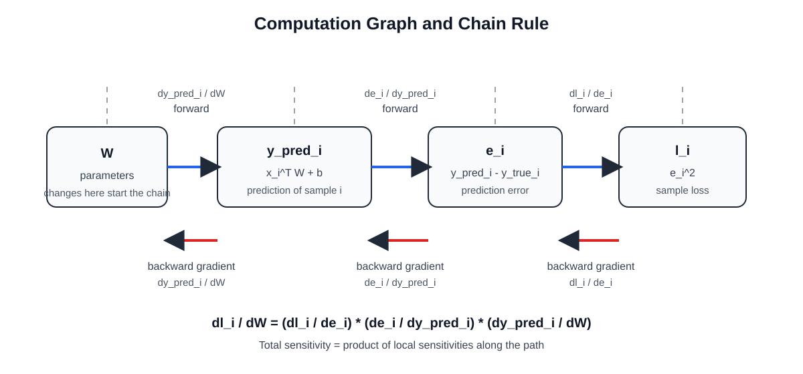

# 线性回归中 `dL/dW` 和 `dL/db` 的完整推导

这份笔记对应 [linear_regression_numpy.py](./linear_regression_numpy.py) 里的这两行：

```python
d_weight = (2.0 / num_samples) * (x.T @ error)
d_bias = float((2.0 / num_samples) * np.sum(error))
```

目标是解释清楚为什么它们分别等于：

```text
dL/dW = (2 / N) * X^T @ (y_pred - y_true)
dL/db = (2 / N) * sum(y_pred - y_true)
```

这里我会先从单个样本开始，用链式法则一步一步推，再把所有样本合并成矩阵形式。

---

## 1. 先定义符号

假设：

- `N` 是样本数
- `d` 是特征维度
- `X ∈ R^(N x d)` 是输入矩阵
- `W ∈ R^(d x 1)` 是权重
- `b ∈ R` 是偏置
- `y_true ∈ R^(N x 1)` 是真实标签
- `y_pred ∈ R^(N x 1)` 是预测值

线性回归模型是：

```text
y_pred = XW + b
```

更精确地说，由于 `b` 是标量，它会广播到每个样本上，所以本质上是：

```text
y_pred = XW + b * 1
```

其中 `1` 表示一个 `N x 1` 的全 1 向量。

损失函数使用均方误差 `MSE`：

```text
L = mean((y_pred - y_true)^2)
  = (1 / N) * Σ_i (y_pred_i - y_true_i)^2
```

定义误差项：

```text
e_i = y_pred_i - y_true_i
```

那么 loss 也可以写成：

```text
L = (1 / N) * Σ_i e_i^2
```

---

## 2. 先推单个样本

先只看第 `i` 个样本。

这个样本的输入记为：

```text
x_i ∈ R^(d x 1)
```

它的预测值是：

```text
y_pred_i = x_i^T W + b
```

它的误差是：

```text
e_i = y_pred_i - y_true_i
```

对应的单样本损失记为：

```text
l_i = e_i^2
```

也就是：

```text
l_i = (y_pred_i - y_true_i)^2
```

现在开始用链式法则。

### 为什么这里会出现链式法则

关键点是：`l_i` 不是直接由 `W` 算出来的。

它中间隔了两层变量：

```text
W -> y_pred_i -> e_i -> l_i
```

也就是说：

- `W` 先影响预测值 `y_pred_i`
- `y_pred_i` 再影响误差 `e_i`
- `e_i` 最后影响损失 `l_i`

所以当 `W` 变化一点点时，`l_i` 的变化不是一步发生的，而是会沿着这条路径一级一级传下去。

把这条依赖关系完全展开，`l_i` 实际上是一个套娃函数：

```text
y_pred_i(W) = x_i^T W + b
e_i(y_pred_i) = y_pred_i - y_true_i
l_i(e_i) = e_i^2
```

合起来就是：

```text
l_i(W) = [ [x_i^T W + b] - y_true_i ]^2
```

链式法则就是专门处理这种“一个变量不是直接依赖，而是通过多层中间变量间接依赖”的工具。

### 为什么链式法则会写成“乘法”

先看最简单的两层情况：

```text
z = f(y)
y = g(x)
```

现在问：`x` 变一点点，会让 `z` 变多少？

把“微小变化”写出来：

```text
dy ≈ (dy/dx) * dx
dz ≈ (dz/dy) * dy
```

把第二式里的 `dy` 用第一式代换掉：

```text
dz ≈ (dz/dy) * (dy/dx) * dx
```

于是：

```text
dz/dx = (dz/dy) * (dy/dx)
```

这就是最基本的链式法则。

如果中间再多一层：

```text
l = h(e)
e = g(y)
y = f(W)
```

同样有：

```text
dl ≈ (dl/de) * de
de ≈ (de/dy) * dy
dy ≈ (dy/dW) * dW
```

把它们串起来：

```text
dl ≈ (dl/de) * (de/dy) * (dy/dW) * dW
```

所以：

```text
dl/dW = (dl/de) * (de/dy) * (dy/dW)
```

这就是为什么会出现：

```text
∂l_i / ∂W
= ∂l_i / ∂e_i * ∂e_i / ∂y_pred_i * ∂y_pred_i / ∂W
```

本质上，它不是“突然多出来一个公式”，而是在说：

```text
总变化率 = 路径上每一段局部变化率的乘积
```

### 把它翻译成这道题里的依赖关系

在当前线性回归里：

```text
y_pred_i = x_i^T W + b
e_i = y_pred_i - y_true_i
l_i = e_i^2
```

所以：

```text
W -> y_pred_i -> e_i -> l_i
```

沿着这条路径反向求梯度时：

```text
∂l_i / ∂W
= ∂l_i / ∂e_i
 * ∂e_i / ∂y_pred_i
 * ∂y_pred_i / ∂W
```

可以把它理解成三句非常直白的话：

1. `l_i` 对 `e_i` 有多敏感？
2. `e_i` 对 `y_pred_i` 有多敏感？
3. `y_pred_i` 对 `W` 有多敏感？

把这三段影响连起来，就是 `W` 对 `l_i` 的总影响。

### 对向量 `W` 为什么也成立

严格地说，`W` 不是一个标量，而是一个向量：

```text
W = [w_1, w_2, ..., w_d]^T
```

所以你也可以先逐个分量看：

```text
∂l_i / ∂w_j
= ∂l_i / ∂e_i * ∂e_i / ∂y_pred_i * ∂y_pred_i / ∂w_j
```

这对每个 `w_j` 都成立。

把所有分量的偏导数收集起来，就组成了整个梯度向量：

```text
∂l_i / ∂W
```

所以“向量版链式法则”本质上仍然是“标量版链式法则对每个分量分别成立，然后再拼起来”。

### 计算图直觉

下面这张图把依赖关系和链式法则放到了同一个视图里：



读图时抓住两件事：

- 正向计算时，值沿着 `W -> y_pred_i -> e_i -> l_i` 这条路径往前走
- 反向求梯度时，敏感度沿着 `l_i -> e_i -> y_pred_i -> W` 这条路径往回传

所以反向传播不是神秘技巧，它只是把链式法则系统化地应用在计算图上。

---

## 3. 推导 `∂l_i / ∂W`

我们要算：

```text
∂l_i / ∂W
```

注意依赖关系是：

```text
W -> y_pred_i -> e_i -> l_i
```

所以根据链式法则：

```text
∂l_i / ∂W
= ∂l_i / ∂e_i * ∂e_i / ∂y_pred_i * ∂y_pred_i / ∂W
```

下面分三步算。

### 第一步：`∂l_i / ∂e_i`

因为：

```text
l_i = e_i^2
```

所以：

```text
∂l_i / ∂e_i = 2e_i
```

### 第二步：`∂e_i / ∂y_pred_i`

因为：

```text
e_i = y_pred_i - y_true_i
```

其中 `y_true_i` 是常数，不随参数变化，所以：

```text
∂e_i / ∂y_pred_i = 1
```

### 第三步：`∂y_pred_i / ∂W`

因为：

```text
y_pred_i = x_i^T W + b
```

对 `W` 求导时，`x_i` 是常量，`b` 也是常量，所以：

```text
∂y_pred_i / ∂W = x_i
```

这里的直觉很简单：

- 如果某个特征 `x_i[j]` 很大
- 那么对应权重 `W[j]` 的改动，对预测值影响也会更大

把三步连起来：

```text
∂l_i / ∂W
= (2e_i) * 1 * x_i
= 2e_i x_i
```

也就是：

```text
∂l_i / ∂W = 2 (y_pred_i - y_true_i) x_i
```

---

## 4. 推导 `∂l_i / ∂b`

同理，`b` 的依赖关系是：

```text
b -> y_pred_i -> e_i -> l_i
```

所以：

```text
∂l_i / ∂b
= ∂l_i / ∂e_i * ∂e_i / ∂y_pred_i * ∂y_pred_i / ∂b
```

前两项刚才已经算过：

```text
∂l_i / ∂e_i = 2e_i
∂e_i / ∂y_pred_i = 1
```

剩下这一项：

```text
y_pred_i = x_i^T W + b
```

对 `b` 求导：

```text
∂y_pred_i / ∂b = 1
```

所以：

```text
∂l_i / ∂b
= (2e_i) * 1 * 1
= 2e_i
```

也就是：

```text
∂l_i / ∂b = 2 (y_pred_i - y_true_i)
```

---

## 5. 从单样本推广到整体 loss

整体损失是：

```text
L = (1 / N) * Σ_i l_i
```

所以对 `W` 求导：

```text
∂L / ∂W
= ∂ / ∂W [ (1 / N) * Σ_i l_i ]
= (1 / N) * Σ_i (∂l_i / ∂W)
= (1 / N) * Σ_i [2e_i x_i]
= (2 / N) * Σ_i e_i x_i
```

对 `b` 求导：

```text
∂L / ∂b
= ∂ / ∂b [ (1 / N) * Σ_i l_i ]
= (1 / N) * Σ_i (∂l_i / ∂b)
= (1 / N) * Σ_i [2e_i]
= (2 / N) * Σ_i e_i
```

代回 `e_i = y_pred_i - y_true_i`：

```text
∂L / ∂W = (2 / N) * Σ_i (y_pred_i - y_true_i) x_i
∂L / ∂b = (2 / N) * Σ_i (y_pred_i - y_true_i)
```

---

## 6. 写成矩阵形式

定义整体误差向量：

```text
error = y_pred - y_true
```

它的 shape 是：

```text
(N, 1)
```

现在看 `X^T @ error`：

- `X` 的 shape 是 `(N, d)`
- `X^T` 的 shape 是 `(d, N)`
- `error` 的 shape 是 `(N, 1)`

所以：

```text
X^T @ error
```

结果 shape 是：

```text
(d, 1)
```

这刚好和 `W` 的 shape 一样。

更重要的是，它本质上就是把每个样本的 `e_i x_i` 全部加起来：

```text
X^T @ error = Σ_i e_i x_i
```

因此：

```text
∂L / ∂W = (2 / N) * X^T @ error
         = (2 / N) * X^T @ (y_pred - y_true)
```

而：

```text
sum(error) = Σ_i e_i
```

所以：

```text
∂L / ∂b = (2 / N) * sum(error)
         = (2 / N) * sum(y_pred - y_true)
```

这就是代码里的两条公式。

---

## 7. 和代码一一对应

在 [linear_regression_numpy.py](./linear_regression_numpy.py) 里：

```python
num_samples = x.shape[0]
error = y_pred - y_true
d_weight = (2.0 / num_samples) * (x.T @ error)
d_bias = float((2.0 / num_samples) * np.sum(error))
```

对应关系如下：

- `num_samples` 就是公式里的 `N`
- `error` 就是公式里的 `y_pred - y_true`
- `x.T @ error` 就是 `Σ_i e_i x_i`
- `np.sum(error)` 就是 `Σ_i e_i`

---

## 8. 这些梯度的直觉是什么

### 对 `W` 的梯度

```text
∂L / ∂W = (2 / N) * X^T @ error
```

它说明：

- 如果某些样本预测偏大，即 `error > 0`
- 并且这些样本在某个特征上取值也大
- 那么这个特征对应的权重梯度就会偏正
- 梯度下降时会减小这个权重

反过来，如果整体预测偏小，更新就会往增大预测值的方向走。

### 对 `b` 的梯度

```text
∂L / ∂b = (2 / N) * Σ_i error_i
```

它说明：

- `b` 控制的是整体平移
- 如果所有样本整体都预测偏大，`Σ error_i` 为正，`b` 会被减小
- 如果所有样本整体都预测偏小，`Σ error_i` 为负，`b` 会被增大

---

## 9. 为什么更新时要减去梯度

参数更新写成：

```text
W := W - lr * ∂L/∂W
b := b - lr * ∂L/∂b
```

原因是：

- 梯度指向 loss 增长最快的方向
- 我们想让 loss 下降
- 所以应该朝梯度的反方向走

这就是梯度下降。

---

## 10. 一元线性回归时会退化成什么样

如果只有 1 个特征，那么：

- `W` 就退化成一个标量 `w`
- `x_i` 也是标量

这时公式会变成你更熟悉的形式：

```text
y_pred_i = wx_i + b
```

损失：

```text
L = (1 / N) * Σ_i (y_pred_i - y_i)^2
```

梯度：

```text
∂L / ∂w = (2 / N) * Σ_i (y_pred_i - y_i) x_i
∂L / ∂b = (2 / N) * Σ_i (y_pred_i - y_i)
```

这和矩阵形式完全一致，只是维度更简单。

---

## 11. 一句话总结

整条推导链其实只有这一句：

```text
loss 对参数的梯度
= loss 对误差的变化率
  * 误差对预测值的变化率
  * 预测值对参数的变化率
```

对单样本：

```text
∂l_i / ∂W = 2 (y_pred_i - y_true_i) x_i
∂l_i / ∂b = 2 (y_pred_i - y_true_i)
```

对全部样本取平均后：

```text
∂L / ∂W = (2 / N) * X^T @ (y_pred - y_true)
∂L / ∂b = (2 / N) * sum(y_pred - y_true)
```

这就是 [linear_regression_numpy.py](./linear_regression_numpy.py) 里那两行梯度代码的来源。
